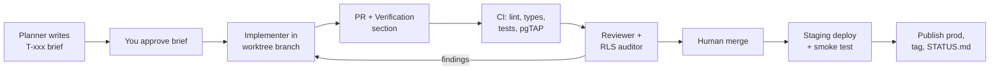

> Copy of the Claude doc "MyChata MVP: critical review and V3 build system". The doc is the working copy; Claude refreshes this file whenever it edits the doc.

# MyChata MVP: critical review and V3 build system

Sep 25, 2026 · @Tuik

**Updated 13 Oct, 10:00.** PR #21 (T-026) is open: it fixes Lovable's preview error and 17 other defects. Two of them hit real users today: the Photos page crashes after a reload on any cottage with photos, and an institution's Approvals page can list confirmed stays with a Decline button that deletes them. So merge and publish it first. The preview broke because Lovable's preview runs in development mode, which never reads `.env.production`, so it started without the database address (B-018); mychata.cz was never affected. Don't press Lovable's "Fix error" button for it. PR #20 (T-025) is merged; publish it together with #21. Three visual directions are on the [design canvas](https://claude.ai/artifact/2d8VVkfmo792i3AL9B8tw1), waiting for your pick. Before the release tag: the 15-minute two-person check. Prompts are in `MyChata MVP/prompts/2026-10-13/` on your Mac.

_How this doc is kept: open work on top, reference sections in the middle, everything finished in Completed at the bottom, oldest first._

## Next steps, in order (13 Oct)

- [ ] 1\. **Merge PR #21 (T-026)** when CI is green, then publish in Lovable (that also publishes PR #20, already merged). Urgent: it stops the Photos page crash and the Approvals page that can delete confirmed stays. After publishing, check that Lovable's preview opens (B-018) and paste rule 8 from `docs/external/lovable/KNOWLEDGE.md` into Lovable's Knowledge. Record: `docs/tasks/T-026-preview-and-defects.md`.
- [ ] 2\. **Pick a visual direction** on the [design canvas](https://claude.ai/artifact/2d8VVkfmo792i3AL9B8tw1): A Fresh air, B Quiet editorial, C Photo-first, or a mix. Comment on the canvas. Then Claude draws the remaining key screens and the institution version, builds the design system in one PR, and Lovable restyles one area per batch. Source files: `MyChata MVP/design/2026-10-13-visual-directions/`.
- [ ] 3\. **Two-person checks** in `prompts/2026-10-13/12-release-two-person-checks.md` (about 15 minutes, with Rajat or your second email): the demoted member's view, the debtor's side of Settle debts, a member's pending stay, a brand-new sign-up, the empty Expenses page, iPhone clipboard, that a plain member sees no "Delete task" and no "Cancel stay" on someone else's stay, and that "Open" in the Document Vault works on an iPhone. If all pass, tag the published commit `release-2026-10-DD`.
- [ ] 4\. **Live-site decisions.** Confirm who owns the `micamail.in` address Lovable tests as (never use it for a real cottage). Confirm the privacy-page wording T-022 added. Decide on Lovable's own page analytics, which still runs after "Essentials only" (seen again on 13 Oct: `~flock.js`, `__l5e/trackevents`).
- [ ] 5\. **Dependabot PR #2** (`actions/checkout` 4 → 7): merge after the release tag. CI is green on it.
- [ ] 6\. **Email.** Check in Lovable whether `notify.mychata.cz` is verified (requested 28 Sep). Then L-E (`05`), CC-3 (`06`), and L-3 (`07`) once G-1's Czech content has been reviewed.
- [ ] 7\. **Document search.** Planning first (`08-CC-4-plan-document-search.md`). T-021 changed the manual answers to read the full text without embeddings, so the T-007 and T-020 plans need re-checking before anyone builds them.

At any time: G-1 (Gemini Czech content, needed before L-3), CP-1 (Copilot tests). **Lovable's new routine:** after each Lovable batch, open a PR from `lovable-sync` into `main`, run the review prompts in `09`, merge when green, and only then publish in Lovable (it publishes lovable-sync, not main). Before publishing, check that Lovable's history shows the latest merge on main (Lovable pulls main into its workspace by itself). Every Claude Code PR gets `09` too, and every publish gets `10`. Older prompt texts: [MyChata: agent prompts from the 26 Sep review](https://claude.ai/code/artifact/7b07f9c1-14fd-4777-8538-cd684a70538e).

## Open tasks and decisions

| Item                                                                                                             | Owner                | Note                                                                                                                                                                                                                                                                                               |
| ---------------------------------------------------------------------------------------------------------------- | -------------------- | -------------------------------------------------------------------------------------------------------------------------------------------------------------------------------------------------------------------------------------------------------------------------------------------------- |
| Rajat is a collaborator (12 Oct). Still to confirm: he ran `git config core.hooksPath .githooks` once            | Rajat                | He checks with: git config --get core.hooksPath (must print .githooks)                                                                                                                                                                                                                             |
| A second GitHub admin                                                                                            | Both                 | A personal repo can't have a second admin. Move the repo into a free GitHub organization you both own, together with the move to own hosting (Model B), because moving it now risks disconnecting Lovable                                                                                          |
| Ask Lovable once: how does it bring `main`'s changes into `lovable-sync`, and which branch does it publish from? | You                  | Answered 12 Oct: Lovable publishes its workspace copy and pushes it to `lovable-sync`. It said it never pulls `main`, but on 12 Oct its workspace did receive the PR #16 merge from `main`, so it does. Rule: publish only after Lovable's PR is merged and Lovable shows the latest `main` commit |
| Write down who holds the Lovable workspace, its publish button and billing; auto top-up yes or no                | Both                 | Credits run out → the manual shows excerpts instead of AI answers                                                                                                                                                                                                                                  |
| Tell members the public links changed                                                                            | You                  | Old calendar and manual links and printed QR codes stopped working on 25 Sep                                                                                                                                                                                                                       |
| Monthly backup, a copy each                                                                                      | Both                 | Last full export 28 Sep; next by 28 Oct. The export has no uploaded photos or documents                                                                                                                                                                                                            |
| Hold the database admin key                                                                                      | You                  | The export works (28 Sep); holding the admin key is still unconfirmed                                                                                                                                                                                                                              |
| Repo public or private                                                                                           | Both                 | Also decides the AGPL question. A maintainer's email from the T-022 brief stays in git history                                                                                                                                                                                                     |
| Staging (T-003) → signed-in tests (T-004) → own hosting (T-002, Model B)                                         | Claude, you          | Before billing or a marketplace. Until staging exists, two-person tests run on production with test cottages                                                                                                                                                                                       |
| Error monitoring (T-006) and an alert both of you read                                                           | Claude, both         | The nightly check was red for two weeks before anyone acted                                                                                                                                                                                                                                        |
| T-014 performance (from B-005), T-015 and T-016 missing tests (CP-1)                                             | Claude, Copilot      | CP-1 also covers the rules T-018, T-021 and T-022 added                                                                                                                                                                                                                                            |
| Legal basics: operator identity, terms, company, trademark, licence, AI data processing                          | You                  | mychata.cz still names no operator                                                                                                                                                                                                                                                                 |
| Talk to 10 families and 3 institutions; 40 manual test questions (T-008)                                         | You                  |                                                                                                                                                                                                                                                                                                    |
| Notion: archive or reference only                                                                                | You                  |                                                                                                                                                                                                                                                                                                    |
| Later: billing (T-009), direct bookings and calendar sync (T-010, T-011)                                         | Later                |                                                                                                                                                                                                                                                                                                    |
| Shared editing of this doc (Claude Team plan)                                                                    | Both                 | Optional; the repo is the shared tracker meanwhile                                                                                                                                                                                                                                                 |
| Visual redesign: pick a direction, then design system, then screen-by-screen restyle                             | You, Claude, Lovable | Mockups first because they are cheap to change; code only once a direction is chosen. Rules stay: 16 px text, 44 px targets, strong contrast                                                                                                                                                       |

## Open defects

| Defect                                                                                                                                                                                                                                                                                                                    | State                                                                                                                                                                     | Next                                                |
| ------------------------------------------------------------------------------------------------------------------------------------------------------------------------------------------------------------------------------------------------------------------------------------------------------------------------- | ------------------------------------------------------------------------------------------------------------------------------------------------------------------------- | --------------------------------------------------- |
| Live until PR #21 is published: Photos page crashes after a reload on cottages with photos (B-019); institution Approvals can list confirmed stays with a Decline that deletes them; an offline start signs people out; a failed read can send a member into onboarding; anyone can cancel any stay with one tap          | Found 13 Oct (T-026), fixed in PR #21, not live                                                                                                                           | Next step 1                                         |
| Lovable's editor preview shows "This page didn't load" (B-018)                                                                                                                                                                                                                                                            | Fixed in PR #21; can only be confirmed in Lovable after the merge                                                                                                         | Next step 1                                         |
| Not yet tested live: the demoted member's own view, the debtor's side of Settle debts, a member's pending stay with admin names, a brand-new sign-up's onboarding, the empty Expenses page, iPhone clipboard, a plain member not seeing "Delete task" or someone else's "Cancel stay", Document Vault "Open" on an iPhone | Need a second person signed in, a fresh account or an iPhone. Everything one admin can test passed on 13 Oct, including the layout at tablet and computer width           | Next step 3                                         |
| Lovable's page analytics runs after "Essentials only"                                                                                                                                                                                                                                                                     | A Lovable hosting feature, not the app's Google Analytics                                                                                                                 | Your decision (next step 4)                         |
| B-004: Google sign-in fails on Brave                                                                                                                                                                                                                                                                                      | In Lovable's sign-in broker; email sign-up works                                                                                                                          | Ask Lovable about using your own Google credentials |
| Missing security headers (Content-Security-Policy, X-Frame-Options)                                                                                                                                                                                                                                                       | Lovable hosting sets them                                                                                                                                                 | Ask Lovable; otherwise Model B                      |
| "Confirm email" for password sign-ups not verified                                                                                                                                                                                                                                                                        | Someone could claim a relative's seat by email match                                                                                                                      | L-E turns it on                                     |
| iPhone photos (HEIC) can't be converted in Chrome or Firefox                                                                                                                                                                                                                                                              | The app explains how to switch the iPhone to JPG; Safari works                                                                                                            | Optional: a HEIC converter in the browser           |
| B-005: Firefox desktop session findings                                                                                                                                                                                                                                                                                   | Three items fixed in PR #21 (one membership claim per page load, one signing request for all photos, AI time limits). Left: slow CORS / HTTP/3 errors on Supabase hosting | Watch; T-002                                        |
| B-008: profile phone empty after save and reload                                                                                                                                                                                                                                                                          | Root cause never confirmed; the test cottage's admin has no phone saved, so it wasn't retested on 13 Oct                                                                  | Step 3: save a phone, reload                        |

## 1. The ecosystem today

The product is sound; the system around it is not yet a business system. The code is small (about 7,000 lines outside the UI kit), which makes now the cheapest moment to fix the foundations.

**What is genuinely good.** Family and institutional modes are cleanly separated. Tasks store both languages instead of translating on render. Consent Mode v2 is set before the tag loads. Public data goes through definer functions, which is the right pattern even where the functions are too open. The migrations show security tightening over time (open policies in `0000`, scoped by `0004`).

| Layer             | Today                                                                                                                                                                                                                               | Problem                                                                                                                                                                                                                                                                                                                          |
| ----------------- | ----------------------------------------------------------------------------------------------------------------------------------------------------------------------------------------------------------------------------------- | -------------------------------------------------------------------------------------------------------------------------------------------------------------------------------------------------------------------------------------------------------------------------------------------------------------------------------- |
| Source of truth   | Four places: Notion PRD and Build Log (named in `.lovable/plan/*.md`), the repo (`AGENTS.md`, `roadmap.md`, `.lovable/plan/`, `docs/build-last-3-responses.md`), the workspace `docs/00–09` outside git, and Lovable's chat history | They disagree. `docs/01` plans a Next.js move although TanStack Start already does SSR; `docs/06` specifies OpenAI 1,536-dim embeddings while the code uses Gemini at 768; `docs/07` CI uses npm on a Bun project; `docs/02` puts V2 in Q2–Q3 2026, already past. The workspace docs aren't versioned and Lovable can't see them |
| Build and deploy  | Lovable edits `main` directly (116 of 119 commits are the bot, most titled "Changes") and publishes to production                                                                                                                   | Production is whatever Lovable last published, not what's on `main`. No PR, no CI, no tag of what's live                                                                                                                                                                                                                         |
| Database          | One Supabase project (`envsfjjefkievkwqbrby`) managed by Lovable Cloud; migrations split across `drizzle/migrations` (11) and `supabase/migrations` (2)                                                                             | No staging database, so every agent migration runs on real family data. `.env.example` tells you to copy the key from the browser's network tab and the service-role key is blank, which suggests you don't hold admin credentials to your own database                                                                          |
| Vendor coupling   | Lovable owns the Vite wrapper, Google OAuth broker (`@lovable.dev/cloud-auth-js`), AI gateway key, error reporting and hosting                                                                                                      | Five separate exits to plan, not one. The data exit is the one that matters                                                                                                                                                                                                                                                      |
| Business plumbing | Privacy page and consent log exist                                                                                                                                                                                                  | No operator identity, terms, or contact on mychata.cz; no email provider (invites are copy-paste links); no billing; no support channel                                                                                                                                                                                          |
| Evidence          | Docs mark V1 "✅ shipped"                                                                                                                                                                                                           | The build log was verified by the same agent that built it. Defects 1–6 above sit inside ✅ items                                                                                                                                                                                                                                |

**Recommendation.** Before any V2 work: (1) confirm you can take a full `pg_dump` and hold the service-role key, (2) collapse to one source of truth inside the repo, (3) put a human-merged PR plus CI between every agent and production. Sections 4–6 give the exact setup.

## 2. Structure for subscriptions, including institutional

The billing unit must be the account, and a person must be able to sit in several accounts. Today neither is true (defect 7), so tiers can't be built on the current schema without a data migration. Do it now while there are few real rows.

**Schema changes, in order**

| Change                                                                                                                                              | Why                                                                                                                                                   |
| --------------------------------------------------------------------------------------------------------------------------------------------------- | ----------------------------------------------------------------------------------------------------------------------------------------------------- |
| `memberships(user_id, account_id, role, status)`, drop the UNIQUE on `members.user_id`                                                              | One person in their family's chata, their in-laws' chata and their employer's institution. `members` stays as "people", some without logins (grandma) |
| `profiles.active_account_id` + `is_member(account_id)` / `has_account_role(account_id, role)` helpers                                               | Replaces `current_account_id() … LIMIT 1` and the global `user_roles.admin`                                                                           |
| `account_id` copied onto `bookings`, `tasks`, `expenses`, `handovers`, `documents`                                                                  | Every policy and every usage count becomes one indexed check instead of a join through `properties`                                                   |
| `plans`, `subscriptions(account_id, plan_id, status, seats, current_period_end, provider_ref)`, `billing_events(provider_event_id UNIQUE, payload)` | Webhooks arrive twice; the unique id makes them idempotent                                                                                            |
| `entitlements` view + `has_entitlement(account_id, feature)` used inside definer functions                                                          | Limits (chatas, storage, AI questions, guest links) enforced in the database, not only hidden in the UI                                               |
| `audit_log(account_id, actor, action, target, at)`                                                                                                  | Institutions will ask who approved which stay. It is also the base of "compliance reports"                                                            |
| Staging project + seed script                                                                                                                       | Billing and tenancy migrations must never be tried first on production                                                                                |

**Institutional reality in Czechia.** Universities, municipalities, trade unions and companies with recreation facilities often pay against an invoice, sometimes through procurement, not by card. Several run employee recreation through the social fund (FKSP) or a union budget. So the institutional plan needs annual invoicing with IČO/DIČ, bank transfer with a QR payment code, a named contract owner, and data-processing terms. Card checkout alone won't close these.

**Payments stack.** Keep SaaS billing and marketplace payments separate. For subscriptions, Stripe Billing with Stripe Tax works, or a merchant-of-record service that takes over EU VAT for B2C, worth weighing for a small team. Marketplace money (guest pays, host receives) is a regulated payment flow and belongs in Stripe Connect or a Czech gateway's equivalent, and only in V2.

**Pricing critique (`docs/03-BUSINESS.md`).** The Free tier drops expense tracking, which is the core family feature and the reason relatives join. Families are also your distribution: every invited cousin is a user. A stronger split:

| Tier          | Who                                    | Charge for                                                                                                      |
| ------------- | -------------------------------------- | --------------------------------------------------------------------------------------------------------------- |
| Family (free) | One family, 1–2 chatas                 | Nothing; generous limits                                                                                        |
| Family Plus   | Families who rent out spare weeks      | Guest links, direct booking, calendar sync, guest registration and tourist-fee reports, more storage, AI manual |
| Institution   | Universities, unions, companies, clubs | Per property per year: request queue, eligibility rules, audit log, CSV/ISDOC export, SSO later                 |

Commission rates tied to plans (12%/8%/5%) should wait until a marketplace exists; putting them in the tier table now anchors a price you can't yet defend.

## 3. Taking share from Airbnb, Booking.com and Couchsurfing by V3

A head-on marketplace won't take meaningful share by V3. Marketplaces win on guest demand, and Booking and Airbnb buy that demand at a scale MyChata can't match. The winnable route is to own the host's side of the chata (its calendar, money, paperwork and history), then send idle weeks to direct bookings, and only then aggregate demand. Airbnb and Booking are built for strangers renting to strangers; MyChata's ground is the chata that is mostly used by its own people.

**Facts that change the plan**

- Czechs make roughly 8 million stays a year in their own holiday homes ([Česko v datech, Eurostat 2018](https://www.ceskovdatech.cz/clanek/155-chaty-a-chalupy/)). That non-commercial use is the biggest segment and nobody serves it. The "500,000+ properties", "Airbnb \~8,000 CZ cabins" and "17% average commission" figures in `docs/00` and `docs/04` have no source; cite or drop them.
- Airbnb has moved most hosts to a single host-only fee of about 15.5% since October 2025 ([Hostaway](https://www.hostaway.com/blog/airbnb-host-only-fee-what-to-know-about-the-15-percent-host-fee/)). Undercutting commission is a thin wedge; a 0% direct booking the owner controls is a thicker one.
- EU Regulation 2024/1028 applies from 20 May 2026: short-term rentals need a registration number where member states require it, and platforms must collect and share host data ([EUR-Lex summary](https://eur-lex.europa.eu/EN/legal-content/summary/online-short-term-accommodation-rental-services-data-collection-and-sharing.html)). Czechia's eTurista register missed its 1 July 2026 launch and is being reworked; guest book, Ubyport reporting of foreign guests and the local tourist fee still apply ([Hostivio](https://hostivio.cz/en/eturista/)). Paperwork is real pain for small hosts, and a wedge.

**The V2 to V3 path**

| Stage | Move                                                                                                                                                  | Why it beats the incumbents                                                                           | Proof metric                                                    |
| ----- | ----------------------------------------------------------------------------------------------------------------------------------------------------- | ----------------------------------------------------------------------------------------------------- | --------------------------------------------------------------- |
| V1.5  | Win families and institutions: calendar, expenses, handover, manual, vault                                                                            | Airbnb and Booking have nothing for co-owners. History (repairs, costs, manuals) is switching cost    | Weekly active chatas; chatas with 3+ active members             |
| V2    | Idle weeks become direct bookings: guest links, friends-of-family pricing, deposit, guest registration, tourist-fee report, registration-number field | Owner keeps 100%; compliance done in the same app                                                     | Share of chatas with a live guest link; direct nights per chata |
| V2    | Two-way iCal with Airbnb and Booking; later a channel-manager partner                                                                                 | MyChata becomes the system of record instead of a rival listing                                       | Chatas syncing at least one external calendar                   |
| V2.5  | Chata swap: owners trade weeks with other owners using points, the HomeExchange model, among verified owners                                          | This is what Couchsurfing's community promised, with trust built on real ownership and known families | Swap nights per month                                           |
| V3    | Public discovery for opted-in chatas only, region by region; AI search once a region has enough supply                                                | Launching demand before supply density loses to Booking's SEO                                         | Bookable chatas per region; search-to-request rate              |

**Cut from the V3 roadmap until supply exists:** native app (a PWA plus email and SMS reaches 45–68-year-olds better), microservices and API gateway, Next.js migration, experiences marketplace, insurance, white-label. Each is a year of work that doesn't move the metrics above.

**Obligations a V3 marketplace takes on** (general knowledge, check with a lawyer): Digital Services Act duties for online platforms, including trader traceability for business hosts; DAC7 reporting of host income to tax authorities; Regulation 2024/1028 data sharing; consumer-law terms; payment regulation for holding guest money. Budget for these before announcing a marketplace.

## 4. Folder and MD structure

Move everything an agent needs inside the git repo, and layer it so each agent loads about 200 lines by default and pulls the rest only when the task calls for it. Today the strategy docs sit outside git where Lovable can't see them, `.instructions.md` at the workspace root is probably loaded by no tool (VS Code expects `.github/copilot-instructions.md` or `.github/instructions/*.instructions.md`), and an agent answering a schema question has to read 1,340 lines of `types.ts` plus 13 migrations.

**Four context layers**

| Layer | Loaded                       | Contents                                                                                                  | Budget            |
| ----- | ---------------------------- | --------------------------------------------------------------------------------------------------------- | ----------------- |
| L0    | Always, by every tool        | Root `AGENTS.md`: stack, commands, invariants, map of where things live                                   | ≤ 150 lines       |
| L1    | When touching that area      | Nested `AGENTS.md` in `supabase/`, `src/routes/`, `src/lib/`; one file per domain in `docs/architecture/` | ≤ 100 lines each  |
| L2    | Per task                     | One brief in `docs/tasks/`: goal, files in scope, acceptance checks, links to L1                          | ≤ 60 lines        |
| L3    | Generated, never hand-edited | `docs/generated/schema.md` (tables, columns, policies, functions), `routes.md`, `STATUS.md`               | Regenerated in CI |

**Proposed tree** (rename the repo folder from `my-chata-manager_LovableCodebaseDownload` to `mychata`)

```
MyChata/                       # workspace, not in git
├─ mychata/                    # the repo = single source of truth
│  ├─ AGENTS.md                # L0; keep Lovable's LOVABLE:BEGIN block as is
│  ├─ CLAUDE.md                # one line: @AGENTS.md (+ Claude-only notes)
│  ├─ GEMINI.md                # pointer to AGENTS.md
│  ├─ .github/
│  │  ├─ copilot-instructions.md   # pointer to AGENTS.md
│  │  ├─ pull_request_template.md  # the review checklist from section 6
│  │  └─ workflows/ci.yml
│  ├─ .claude/
│  │  ├─ agents/              # subagent definitions (section 5)
│  │  └─ skills/              # new-migration, rls-audit, release, task-brief
│  ├─ docs/
│  │  ├─ README.md            # index, 20 lines
│  │  ├─ product/             # vision, personas, pricing (from docs/00, 03, 04)
│  │  ├─ architecture/        # tenancy.md, auth.md, rag.md, billing.md
│  │  ├─ decisions/           # ADR-0001-keep-tanstack-start.md … short, numbered
│  │  ├─ tasks/               # T-012-fix-match-manual-chunks.md
│  │  ├─ external/            # inbound work from Lovable, Gemini (section 8)
│  │  ├─ generated/           # schema.md, routes.md (CI writes these)
│  │  └─ STATUS.md            # live commit, open defects, what is verified
│  ├─ supabase/
│  │  ├─ AGENTS.md            # migration + RLS rules
│  │  ├─ migrations/          # ONE migration folder
│  │  ├─ tests/               # pgTAP RLS tests
│  │  └─ seed.sql             # staging only, never production
│  ├─ src/ …                   # unchanged, plus src/routes/AGENTS.md
│  └─ tests/e2e/               # Playwright
├─ private/                    # screenshots with personal data, exports
└─ .env.local                  # never inside the repo
```

**Rules that keep it token-efficient**

- One fact, one file. Every other file links to it instead of restating it (the stack is currently restated in five files).
- `docs/00–09` get split, not copied: decisions become ADRs, plans become task briefs, facts that code can prove get generated.
- `.lovable/plan/*.md` stays Lovable's scratch space; anything that becomes a decision is lifted into an ADR by the reviewer.
- A decision replaced is marked `Superseded by ADR-00xx`, never silently edited, so agents don't resurrect old plans.
- Nested `AGENTS.md` support differs by tool, so the root file must still work alone; nested files add detail only.

**Root AGENTS.md skeleton**

```markdown
# MyChata — agent guide

Stack: TanStack Start 1.168 (SSR, Cloudflare via Nitro) · React 19 · Supabase · Bun. Not Next.js.
Run: bun install · bun run dev · bun run check (lint+typecheck+test)

## Invariants (breaking one = PR rejected)

1. Tenancy: every table has account_id + RLS using is_member(account_id). No SECURITY DEFINER without an account check.
2. Schema changes only as a new file in supabase/migrations/. Never the SQL editor.
3. No direct pushes to main. Branch agent/<tool>/<task-id>, PR, CI green, human merge.
4. Never rewrite pushed history (Lovable sync).
5. User-facing text via t(cs, en). Czech first.

## Where things are

Schema: docs/generated/schema.md · Routes: docs/generated/routes.md · Status: docs/STATUS.md
Tenancy/auth: docs/architecture/tenancy.md · RAG: docs/architecture/rag.md

## Before you finish

Update STATUS.md if behaviour changed. List what you verified and how.
```

## 5. Subagent handover and workflow

Split agents by what they do (plan, build, review, verify), not by topic, and give each task a brief with a file allowlist and runnable acceptance checks. The current plan in `docs/09-AGENT-TASKS.md` splits by topic (Architect, Tester, Analyst…), runs overlapping agents in the same weeks on the same files (Guardian and Commerce both rewrite RLS), and hands them briefs that are wrong: `docs/agents/rag-setup.md` indexes `properties.title`, `description` and `location`, none of which exist; the Growth brief assumes Next.js; the Commerce brief assumes Supabase Edge Functions; Guardian is asked to build consent and data export, which already exist.

**Roles**

| Role           | Runs as                                              | Tools                                                                 | Can write                      | Output                                                      |
| -------------- | ---------------------------------------------------- | --------------------------------------------------------------------- | ------------------------------ | ----------------------------------------------------------- |
| Planner        | Claude (chat or Claude Code, plan mode)              | Read-only repo, docs                                                  | `docs/tasks/T-xxx.md` only     | A brief (template below)                                    |
| Implementer    | Claude Code subagent, one per task, own git worktree | Bun, Supabase CLI against local/staging, Playwright                   | Files in the brief's allowlist | Branch `agent/claude/T-xxx`, PR with a Verification section |
| UI implementer | Lovable, on its own branch                           | Lovable editor                                                        | `src/routes`, `src/components` | PR, never direct publish                                    |
| Reviewer       | Fresh Claude Code subagent that never saw the build  | Read-only + `gh pr diff`                                              | PR comments                    | Findings ranked by severity                                 |
| RLS auditor    | Subagent, runs on any PR touching `supabase/`        | pgTAP, `supabase db lint`, read-only                                  | Tests only                     | Pass/fail per invariant                                     |
| Verifier       | CI, not an agent                                     | GitHub Actions: lint, typecheck, Vitest, pgTAP, Playwright on staging | Nothing                        | Green or red                                                |
| Merger         | You or Ranaji                                        | GitHub                                                                | `main`                         | Merge, then `STATUS.md` updated                             |

The skills already available here that fit: `engineering:code-review` for the Reviewer, `engineering:testing-strategy` and `engineering:debug` for the Verifier lane, `engineering:architecture` for ADRs, `engineering:deploy-checklist` before each production publish.

**The workflow for every task**



A red step always returns to the Implementer with the failing output attached, never to a new agent starting cold.

**Parallel work rules**

1. Two tasks run in parallel only if their file allowlists don't overlap.
2. Migrations run in one lane, one at a time, numbered at merge.
3. Any task touching tenancy, auth, billing or RLS gets the RLS auditor and a human read of the SQL, whatever CI says.
4. An agent that needs a file outside its allowlist stops and asks; it does not widen its own scope.

**Task brief template** (`docs/tasks/_TEMPLATE.md`, replaces `docs/specs/_TEMPLATE.md`)

```markdown
# T-012 Close cross-tenant read in match_manual_chunks

Goal: one sentence. Non-goals: what not to touch.
Files allowed: supabase/migrations/NEW, supabase/tests/manual_chunks.sql, src/lib/manual-qa.functions.ts
Invariants touched: 1 (tenancy)
Context (max 5 links): docs/architecture/rag.md, docs/generated/schema.md#manual_chunks
Acceptance (must run green):

- pgTAP: user of account A gets 0 rows for property of account B
- bun run check
  Handoff note: what changed, what was verified and how, what is still unverified.
```

**Order of lanes to V3**

| Weeks | Lane            | Content                                                                                            |
| ----- | --------------- | -------------------------------------------------------------------------------------------------- |
| 1–2   | Foundation      | Data export check, staging project, repo consolidation, CI, branch protection, Lovable on a branch |
| 2–4   | Fix + tenancy   | Defects 1–12, memberships migration, pgTAP suite                                                   |
| 4–6   | V1.5            | Email provider (invites, reminders), notifications, Sentry, onboarding polish                      |
| 6–10  | Billing         | Plans, subscriptions, entitlements, invoicing for institutions                                     |
| 8–14  | Direct bookings | Guest links v2, deposits, guest registration, tourist-fee report, iCal sync                        |
| 10+   | RAG + discovery | Section 7 stages                                                                                   |

These are estimates for a small team using agents full-time; adjust after the first two lanes show real velocity.

## 6. Guardrails, review, verification and debug

The code-level guardrails are decent; the process guardrails are missing, which is why defects 1–6 shipped under ✅. There are zero test files, no `typecheck` script, no CI, no branch protection, no staging database, and the only verification is the building agent checking its own work. Nitro runs on a beta build (`3.0.260603-beta`) in production.

**Already in place:** Zod validation on server functions, `requireSupabaseAuth` middleware, RLS enabled on every table, a honeypot on the guest form, timing-safe cron auth, `.env` untracked (the file removed from history held only publishable values).

**Guardrails to add, and which defect each would have caught**

| Guardrail                  | How                                                                                                                                                                   | Catches                               |
| -------------------------- | --------------------------------------------------------------------------------------------------------------------------------------------------------------------- | ------------------------------------- |
| Schema drift check         | CI runs `supabase gen types` against staging and fails if it differs from the committed `types.ts`                                                                    | 2 (code writes a column the DB lacks) |
| No ignored database errors | Wrapper or lint rule: every Supabase call must handle `error`                                                                                                         | 2, 6                                  |
| Definer-function lint      | CI script: each `SECURITY DEFINER` function must call `is_member`/`current_account_id` or be on a reviewed allowlist; each `GRANT … TO anon` needs an allowlist entry | 1, 3, 4                               |
| RLS test matrix            | pgTAP: anon, member of A, admin of A, member of B × every table × select/insert/update/delete                                                                         | 1, 3, 4, 9, 10                        |
| E2E on staging             | Playwright with 4 test accounts: onboarding, invite an existing user, guest request, make admin, settle expense                                                       | 5, 6, 7                               |
| Claims ledger              | `STATUS.md`: every ✅ links to a test or a dated manual check by someone other than the builder                                                                       | Docs that overstate                   |
| Independent review         | Reviewer subagent with no build context; human reads every migration                                                                                                  | 1, 7, 9                               |
| Release tagging            | Tag each Lovable publish with the commit; Sentry `release` = commit SHA                                                                                               | Old build live (screenshot)           |
| Kill switches              | `feature_flags` row per risky feature (AI, guest links) checked server-side                                                                                           | Cost spikes, abuse                    |
| Rate limits                | Per-user daily counters on AI calls and public forms                                                                                                                  | 11                                    |
| Dependency hygiene         | Dependabot, secret scanning, pinned non-beta Nitro when available                                                                                                     | Supply-chain, secret leaks            |

**Integrating output from several agents.** The risky joins are schema versus code, and Lovable output versus local agent output. Three rules:

1. The database schema is the contract. Only the migration lane changes it; every other agent regenerates types and adapts.
2. Lovable doesn't run Prettier, so a format check in CI would fail every Lovable PR. Either auto-format in CI on Lovable branches, or make one format-only commit while Lovable is idle. The 60-file reformat sitting uncommitted in your local copy is exactly this collision waiting to happen.
3. The Verification section of a PR must list commands run and their output; "tested" without output counts as untested.

**Debug structure.** Bug report in `docs/bugs/B-xxx.md` (screenshot, URL, time, account type, device) → failing test that reproduces it → fix → the test stays. Sentry for client and server errors, alongside Lovable's reporting until you leave it. For the iOS "?" screenshot, the reproduction is: new Google account, not invited, open `/vice` on the build that is actually live.

## 7. RAG pipeline

There is no working RAG pipeline yet: Stage 1 almost certainly stores nothing (defect 2), and its retrieval function crosses tenants (defect 1). The design also needs changing before it's extended. `docs/06` is a generic reference architecture that doesn't match the code (OpenAI 1,536-dim vs Gemini 768, Supabase Edge Functions vs TanStack server functions).

**Design problems beyond the two defects** (`src/lib/manual-qa.functions.ts`, `0007_*.sql`)

- Rebuild deletes every chunk first, then re-embeds; one failed call leaves the manual unsearchable.
- Members-only and public sections go into one index with no visibility column, so any future guest or public Q&A would leak private sections.
- A whole section is one chunk, with no content hash, so every save re-embeds everything.
- No test questions, so nobody can tell whether retrieval works.

**Target design**

| Piece           | Choice                                                                                                                                                                                                                                                               |
| --------------- | -------------------------------------------------------------------------------------------------------------------------------------------------------------------------------------------------------------------------------------------------------------------- |
| One table       | `rag_chunks(account_id, property_id, source_type, source_id, visibility, lang, content, content_hash, embedding vector(768), model_version, tsv)` with HNSW and GIN indexes, RLS by `is_member` and visibility                                                       |
| Ingestion       | Triggers on source tables write to `embedding_jobs`; a cron worker (the repo already has `cron-auth.ts`) embeds, upserts by `content_hash`, retries failures. No delete-then-rebuild                                                                                 |
| Retrieval       | `search_chunks(…)` as SECURITY INVOKER so RLS applies; hybrid: vector plus full-text with `unaccent` (Postgres ships no Czech stemmer), merged by reciprocal rank fusion                                                                                             |
| Structured data | Bookings, expenses, tasks are queried with SQL tools, never embedded. "Who's at the chata next weekend" is a query, not a similarity search                                                                                                                          |
| Models          | Keep Gemini embeddings (good Czech), pin `output_dimensionality: 768` and record `model_version`. Decide in an ADR whether private manuals go through Lovable's gateway or directly to Google in an EU region; that's a GDPR processor question, not a technical one |
| Evaluation      | 40 Czech and English questions per test chata with the expected source ids. CI on staging reports recall@4 and fails below a set bar; a sampled answer-faithfulness check weekly                                                                                     |

**Stages to V3**

| Stage   | Sources                                              | Who asks                       | Unlocks                                                                                                                                   |
| ------- | ---------------------------------------------------- | ------------------------------ | ----------------------------------------------------------------------------------------------------------------------------------------- |
| 1 (fix) | Manual sections                                      | Members                        | Working Q&A with citations                                                                                                                |
| 2       | + documents (PDF text), handover notes, closed tasks | Members, admins per visibility | "When was the boiler last serviced?", "Where's the pump warranty?" This private history is the data moat                                  |
| 3       | Public listing profiles only, separate index         | Anyone                         | Natural-language discovery, parsed into filters (dates, beds, region, dogs) first, semantic rerank second, only available chatas returned |
| 4       | Stage 2 + SQL tools                                  | Hosts and guests               | Host copilot and guest concierge as a tool-using agent, not a bigger prompt                                                               |

**Agent-run build of Stage 1 and 2** (each is one brief, one PR, section 5 workflow)

| Task                        | Owner                        | Done when                                                                 |
| --------------------------- | ---------------------------- | ------------------------------------------------------------------------- |
| T-R1 schema + RLS + pgTAP   | Migration lane               | Tenant-B test returns 0 rows; public/members split proven                 |
| T-R2 job queue + worker     | Implementer                  | 100 sections embedded on staging, re-save of unchanged text makes 0 calls |
| T-R3 hybrid search function | Implementer                  | Golden set recall@4 reported in CI                                        |
| T-R4 `askManual` rewrite    | Implementer                  | Answers cite source ids; refuses when nothing is retrieved                |
| T-R5 golden set             | Planner + you (native Czech) | 40 questions reviewed by a person                                         |
| T-R6 UI                     | Lovable branch               | Sources shown and tappable                                                |
| Review                      | Reviewer + RLS auditor       | On every PR above                                                         |

T-R5 needs you rather than an agent: the test questions define what "good" means for Czech users aged 45–68.

## 8. Work from Lovable, Gemini Enterprise and other platforms

`docs/08-EXTERNAL-AGENTS.md` has the right instinct (GitHub as truth, externals on branches) but one contradiction: it moves Lovable to a `lovable/experiments` branch while Lovable still publishes production. Whatever Lovable publishes from that branch goes live, bypassing `main`. So pick a hosting model first; the protocol follows from it.

|                       | Model A: keep Lovable hosting (now)                                    | Model B: own hosting (target, about 4–8 weeks)                                                                 |
| --------------------- | ---------------------------------------------------------------------- | -------------------------------------------------------------------------------------------------------------- |
| Production built from | Lovable publish of `main`                                              | GitHub Actions deploy of `main` to your own Cloudflare Workers (Nitro already targets it; `.wrangler/` exists) |
| Database              | Lovable Cloud Supabase                                                 | Your own Supabase project, data migrated, you hold the service key                                             |
| Google sign-in        | Lovable's broker                                                       | Configured directly in Supabase                                                                                |
| Lovable's role        | Edits `main`, UI only, publishes only after CI is green on that commit | One contributor on a branch, PRs like any agent                                                                |
| Risk                  | Lovable can still run SQL on production                                | Normal PR flow for everyone                                                                                    |

Stay on Model A until the foundation lane (section 5) is done, then move. Moving before tests exist just relocates the risk.

**One protocol for every outside platform**

1. **Inbound packet.** The platform gets a task brief, `AGENTS.md`, `docs/generated/schema.md` and the named files. Never secrets, never production data; staging seed data only. Sending real families' names and phone numbers to an outside AI is a GDPR processing decision that needs a data-processing agreement.
2. **Outbound landing.** Code arrives as a PR from `agent/<platform>/<task-id>`. Research and content arrive as `docs/external/<platform>/YYYY-MM-DD-<topic>.md` with frontmatter `source`, `model`, `date`, `status: draft|reviewed|adopted`.
3. **Same gates.** CI, Reviewer, RLS auditor and human merge apply regardless of which platform wrote it.
4. **Output is data.** Text from outside platforms is never run as a command or pasted into prompts as instructions without a person reading it.

**Per platform**

| Platform                            | Use it for                                                           | Never                                                                                                         | Access it gets                                                                                          |
| ----------------------------------- | -------------------------------------------------------------------- | ------------------------------------------------------------------------------------------------------------- | ------------------------------------------------------------------------------------------------------- |
| Lovable                             | UI screens, copy, visual iteration                                   | Migrations, RLS, auth, billing, server functions (put this in Lovable's project Knowledge and in `AGENTS.md`) | Repo via its GitHub app                                                                                 |
| Gemini Enterprise                   | Market and regulation research, Czech content drafts, Workspace docs | Code merged without PR; production data                                                                       | Read-only Drive/GitHub connectors; GA4 data through the free BigQuery export rather than live DB access |
| Claude (Code, chat, this workspace) | Planning, implementation in worktrees, review                        | Direct push to `main`                                                                                         | Repo, staging database                                                                                  |
| Copilot / Cursor / others           | Inline edits in the IDE                                              | Changing invariants files without review                                                                      | Local repo                                                                                              |
| MCP servers (Supabase, GitHub)      | Letting agents inspect schema, PRs, issues                           | Write access to production                                                                                    | Supabase MCP in read-only mode pinned to the staging project; GitHub token scoped to one repo, no admin |

**Notion.** The Lovable plans cite a Notion PRD and Build Log. Either move their decisions into the repo as ADRs and mark Notion as archive, or keep Notion as the product source and have the repo link to page URLs. Two live copies is how `docs/02` ended up planning a Q2 2026 V2.

## 9. Two maintainers and the Lovable setup (26 Sep)

Add Rajat as a collaborator on the existing repo now. Don't move the repo or leave Lovable yet: stay on Model A with a ruleset until staging and signed-in tests exist, then move to Model B. Rajat and you each work on your own branches. Lovable stays the only thing that writes straight to main, and only for screens.

**The repo.** It lives at ranaji10/mychata (public). GitHub has no way to add an account "as a branch". Instead, add Rajat under Settings → Collaborators with the Write role. He then works on branches named after his GitHub username and opens PRs like everyone else. Keep the repo where it is for now, because Lovable's sync is tied to it and moving or renaming it can disconnect Lovable. When you move to Model B, transfer it to a GitHub organization you both own, so the business doesn't depend on one personal account.

**The Lovable link.** Lovable was reconnected to the repo on 27 Sep and pulls from main on the next merge; it can't pull retroactively. Write down who holds the Lovable workspace, its publish button and its billing (Open tasks). Don't reconnect it again without need: each reconnection risks a new repo and split history.

**Guardrails for two people.** The CI migration guard, the sync check with its git hooks and VS Code task, and the two-person runbook are live since PR #7 (see Completed). The rulesets on `main` were redone on 12 Oct (see "GitHub settings check" in Completed); Lovable now works on the branch lovable-sync and reaches main through a PR.

**Lovable environment.** Keep one Lovable workspace with both of you as members, and one person driving it at a time. It edits main for screens and wording only, under the Knowledge rules, with nothing published before CI is green. The prompt batches L-1 to L-3 follow those rules.

**Leaving Lovable for Claude via MCP?** Claude already does everything except screens, through PRs. You could stop using Lovable's editor any day. But Lovable also hosts the site, runs the database, brokers Google sign-in and holds the AI key, and an MCP connection replaces none of these. So the real move is Model B, in this order: staging (T-003) → signed-in end-to-end tests (T-004) → own Supabase and hosting (T-002). Moving before those exist just moves the risk. The 4–8 week estimate stands. Give agents the Supabase MCP only read-only, and only against staging.

**Lovable's MCP connector for Claude: not now.** It connects from Claude's side, not from Lovable's workspace settings. It gives Claude your whole Lovable account, including running SQL on the live database and publishing, and it would bypass every PR, CI and migration rule above. Lovable's own "chat connectors" work the other way (Lovable's agent reaching your tools), so a Claude connector there adds nothing.

**Email: decided.** Lovable's built-in email, from no-reply@notify.mychata.cz, with replies going to podpora@mychata.cz. It's included in paid workspaces, needs no extra vendor, and covers sign-in emails too. Steps: docs/tasks/T-005-email.md; prompts L-E and CC-3 are in the prompts doc.

**AI and credits.** Every AI call and email bills to the Lovable workspace "My Lovable", which holds the project. The monthly AI grant is used first, then general credits. When credits run out, the manual shows the best-matching excerpt instead of an AI answer. This is recorded in docs/architecture/environments.md.

**Sharing this doc with Rajat.** Edit rights in a Claude doc only reach people in the same Claude organization; a public link is read-only. Three routes:

1. **Claude Team plan** with both of you as members (third-party reports put it at a 2-seat minimum; check claude.com/pricing). Then Share gives him edit rights, and you can share Projects too.
2. **Ask Anthropic** for cross-account editing: use the thumbs-down feedback button in the app, or support.claude.com.
3. **Use the repo as the live tracker** (recommended now). Every Claude session, yours or his, already writes its results into the repo through PRs: docs/STATUS.md, the task briefs, and copies of Claude docs in docs/external/claude/. GitHub Issues can hold the to-do list, with comments from both sessions. It has history, needs no new tools, and two sessions can't overwrite each other.

A Google Doc edited by two Claude accounts through the Drive connector won't work. The connector available here can create files and rename or move them, but it can't edit an existing document's content. Even with a connector that could, two sessions writing the same doc would overwrite each other without warning.

## Questions you haven't asked yet

| Question                                                                                 | Why it matters                                                                                                                                                                 |
| ---------------------------------------------------------------------------------------- | ------------------------------------------------------------------------------------------------------------------------------------------------------------------------------ |
| Can we take a full export of the production database today, and who holds its admin key? | If the answer is "only Lovable", every other plan here depends on a vendor's goodwill                                                                                          |
| How many real families and institutions use it weekly, and what have ten of them said?   | Nothing in the folder records a user conversation. Pricing, the free tier and the V3 path are all guesses until then                                                           |
| Who is the legal operator, and who has merge rights?                                     | mychata.cz shows no operator, terms or contact. Two people (the Mac user and the `ranaji10` GitHub owner) with unclear decision rights will collide once agents open PRs daily |
| Why AGPL-3.0, added this morning, on a private commercial repo?                          | It barely matters while private, but opening it later, or dual-licensing, needs a deliberate choice about who owns contributions. Check Lovable's terms on generated code      |
| Is "My Chata" / mychata.cz clear to trademark in CZ and the EU?                          | Cheap to check at ÚPV and EUIPO now, expensive after a brand campaign                                                                                                          |
| What happens to a family's documents if they delete their account or stop paying?        | Ownership deeds and insurance papers live in the vault; retention, export and deletion rules must exist before billing                                                         |
| Are backups and point-in-time recovery on, and has a restore ever been tested?           | One bad agent migration on the only database is the most likely serious incident                                                                                               |
| Who pays for AI calls, and at what usage does the free tier stop being free?             | Answered 26 Sep: the "My Lovable" workspace pays, and daily caps exist since migration 0015. Still open: auto top-up yes or no                                                 |
| How many hours a week does this get against the other ventures?                          | The lane plan in section 5 assumes steady attention; a V3 marketplace needs a funded growth budget on top                                                                      |
| What tells us production is broken, and who reads it?                                    | The nightly check failed five nights in a row and nobody acted. GitHub's failure emails reach one account; T-006 plus a channel you both read fixes that                       |
| Which commit is live right now?                                                          | There is still no release tag. What's live was worked out on 4 Oct from the site's behaviour. A tag after every publish answers it in one click                                |
| Who is the second person for two-person tests until staging exists?                      | Settle debts, invitations and demotion need two real accounts. Agree which accounts, use test cottages only, and delete them afterwards                                        |
| Should our status, bug reports and plans be public?                                      | The repo is public, so all of docs/ is. Fine for code; less so for business plans and anything that names a person                                                             |

## Sources

- [Online short-term accommodation rental services: data collection and sharing (EUR-Lex summary of Regulation 2024/1028)](https://eur-lex.europa.eu/EN/legal-content/summary/online-short-term-accommodation-rental-services-data-collection-and-sharing.html)
- [eTurista 2026: not launched on 1 July (Hostivio)](https://hostivio.cz/en/eturista/)
- [Airbnb host-only fee explained (Hostaway)](https://www.hostaway.com/blog/airbnb-host-only-fee-what-to-know-about-the-15-percent-host-fee/)
- [Chaty a chalupy (Česko v datech, Eurostat 2018 data)](https://www.ceskovdatech.cz/clanek/155-chaty-a-chalupy/)
- Code evidence: `MyChata MVP` folder on your Mac, repo commit `23d71f2` plus uncommitted local changes, read on 25 Sep 2026; live home page of mychata.cz on the same date.

## Completed

Finished work, oldest first. Details for each step are in the repo: `docs/STATUS.md`, `docs/bugs/`, and the pull requests.

### Chain of events

| When                | What happened                                                                                                                                                                                                                                                                                                                                                                                                                                                                                                                                                                                                                                                                                  | Evidence                                      |
| ------------------- | ---------------------------------------------------------------------------------------------------------------------------------------------------------------------------------------------------------------------------------------------------------------------------------------------------------------------------------------------------------------------------------------------------------------------------------------------------------------------------------------------------------------------------------------------------------------------------------------------------------------------------------------------------------------------------------------------- | --------------------------------------------- |
| 25 Sep              | Critical review written (sections 1–9).                                                                                                                                                                                                                                                                                                                                                                                                                                                                                                                                                                                                                                                        | This doc                                      |
| 25 Sep              | Fixes for defects 1–13 built, 35 tests passing; PR #1 merged. Lovable Knowledge rules pasted. main protected against force pushes and deletion; secret scanning and Dependabot on.                                                                                                                                                                                                                                                                                                                                                                                                                                                                                                             | PR #1                                         |
| 25 Sep              | Lovable switched back from lovable/experiments to main. Migrations 0011–0015 applied to the live database through an empty 0016, with no data lost (8 members, 4 profiles, 3 chatas).                                                                                                                                                                                                                                                                                                                                                                                                                                                                                                          | Lovable, regenerated types                    |
| 25 Sep, 18:00       | Live site on the new build: a wrong form link is refused, and the home page no longer links to the demo university's form.                                                                                                                                                                                                                                                                                                                                                                                                                                                                                                                                                                     | Browser check                                 |
| 25 Sep, 18:16       | CI green again after Lovable's commit broke it.                                                                                                                                                                                                                                                                                                                                                                                                                                                                                                                                                                                                                                                | PR #3                                         |
| 25 Sep, 20:30       | Outage B-002: a publish built the app without its Supabase settings. Fixed with a committed `.env.production` and a CI guard, then republished. Full database backup taken (30 tables plus sign-in accounts; no uploaded files).                                                                                                                                                                                                                                                                                                                                                                                                                                                               | PR #4, B-002                                  |
| 26 Sep, 01:00       | Site back up. The first five checks found B-003 (members sent to onboarding).                                                                                                                                                                                                                                                                                                                                                                                                                                                                                                                                                                                                                  | B-003                                         |
| 26 Sep, 02:34       | B-003 fixed, new link-preview image, nightly production check added; 0017 live. Lovable added 0018, a copy of 0017 (harmless, kept).                                                                                                                                                                                                                                                                                                                                                                                                                                                                                                                                                           | PR #5                                         |
| 26 Sep, 03:25       | Cleanup: release checklist, design rules saved from Lovable's memory, Knowledge rules 3a and 9. Lovable memory entries deleted, old GitHub branches deleted. The GitHub 500 errors were on GitHub's side.                                                                                                                                                                                                                                                                                                                                                                                                                                                                                      | PR #6                                         |
| 26 Sep, 10:33       | First nightly production check passed.                                                                                                                                                                                                                                                                                                                                                                                                                                                                                                                                                                                                                                                         | GitHub Actions                                |
| 26 Sep, 13:30       | Live database probed as an anonymous visitor: the fixes hold. Bot audit done. Gemini review triaged into the prompts doc.                                                                                                                                                                                                                                                                                                                                                                                                                                                                                                                                                                      | Prompts doc                                   |
| 26 Sep              | Decided: no approvals between partners; email through Lovable's built-in email; AI and email billed to the "My Lovable" workspace; no Lovable connector for Claude for now; the repo is the shared tracker.                                                                                                                                                                                                                                                                                                                                                                                                                                                                                    | T-005, environments.md                        |
| 26–27 Sep           | Two-person setup merged: CI migration guard, sync check with git hooks and a VS Code task, two-person runbook, email plan, copies of Claude docs in the repo. Tag `baseline-2026-09-26` on 7d5d8b7. Lovable reconnected to the repo, waiting for the next merge to pull.                                                                                                                                                                                                                                                                                                                                                                                                                       | PR #7                                         |
| 28 Sep              | CC-1 (T-017) built by Claude Code and reviewed: code, database rules, new security tests and formatting all check out. The branch was wrongly set to track main, which could have pushed it straight to main; that link was removed.                                                                                                                                                                                                                                                                                                                                                                                                                                                           | Branch agent/claude/T-017-review-bugs         |
| 28 Sep, 14:48       | CC-1 merged; Lovable pulled and published it.                                                                                                                                                                                                                                                                                                                                                                                                                                                                                                                                                                                                                                                  | PR #8                                         |
| 28 Sep, 17:27–18:35 | Release checks and CC-1 checks recorded on the live site: every request succeeded (sign-in, two invitations, manual answer, public calendar, booking, half-done handover, profile save). One iPhone photo was refused in Firefox with the new "wrong file type" message, as designed.                                                                                                                                                                                                                                                                                                                                                                                                          | Recordings in private/Screenshots/28092026    |
| 28 Sep              | Maintainer review notes triaged. Root causes found: email sign-up crashed before sending anything; admin invitations became members (lower-case role); the invitation link was lost at sign-in; Home never read the main photo.                                                                                                                                                                                                                                                                                                                                                                                                                                                                | B-011 to B-017                                |
| 28 Sep, 19:10       | T-019 and T-012 built on a branch. All migrations replayed on an in-memory Postgres: 36 database tests pass, including the new invitation and demo-removal tests; 25 unit tests pass; lint 0 errors; formatting matches CI.                                                                                                                                                                                                                                                                                                                                                                                                                                                                    | Branch agent/claude/T-019-invites-signin-demo |
| 28 Sep, 19:40       | Database export taken before the demo removal (Lovable DB exports folder). First CI run of T-019 failed on one type in the invite email helper; fixed.                                                                                                                                                                                                                                                                                                                                                                                                                                                                                                                                         | Commit abeda7f                                |
| 28 Sep, 21:12       | T-019 and T-012 merged. Lovable applied 0019 and 0020 through an empty marker (0021) and published. Demo family, fake university and their storage folders removed.                                                                                                                                                                                                                                                                                                                                                                                                                                                                                                                            | PR #10                                        |
| 28 Sep, evening     | Maintainer walkthrough of T-019 on the live site: 15 notes, among them the members page crashing, no admin left after the demo removal, a non-admin able to confirm a guest booking, and Document Vault questions doing nothing.                                                                                                                                                                                                                                                                                                                                                                                                                                                               | T-021 brief                                   |
| 29 Sep, 06:25       | T-021 merged (migration 0022, three admin-checked database functions). Lovable applied it as 0023, a copy of 0022: harmless, but against Knowledge rule 3a.                                                                                                                                                                                                                                                                                                                                                                                                                                                                                                                                    | PR #11                                        |
| 29 Sep, morning     | Claude's live test at phone size: most flows work. 11 problems fixed, among them Settle debts and task detail never opening, people left without an account landing on an empty Home, and clear messages for links that aren't valid. Tests ran in CI only (the computer disconnected).                                                                                                                                                                                                                                                                                                                                                                                                        | PR #12, T-022                                 |
| 29 Sep, 10:11       | CC-2 merged (T-018, migration 0024: checklists, booking defaults, "cover it all", new tasks assigned to their creator). Lovable applied it through an empty marker (0025), as rule 3a says.                                                                                                                                                                                                                                                                                                                                                                                                                                                                                                    | PR #13                                        |
| 29 Sep, 10:13–10:29 | Lovable built L-1: Settings tab, share sheet, chata switcher, Home and the public calendar. CI on main went red twice on formatting; PR #14 fixed it.                                                                                                                                                                                                                                                                                                                                                                                                                                                                                                                                          | PR #14                                        |
| 29 Sep – 3 Oct      | Nightly production check red every night. Cause: the test, not the site (see Open defects).                                                                                                                                                                                                                                                                                                                                                                                                                                                                                                                                                                                                    | GitHub Actions                                |
| 3 Oct, 23:26        | Two rulesets on main: PR required with 0 approvals, branches up to date, one app on the bypass list; no deletion, no force push.                                                                                                                                                                                                                                                                                                                                                                                                                                                                                                                                                               | GitHub settings                               |
| 4 Oct               | GitHub settings checked against the workflow; prompts for every remaining agent written to the Mac (prompts/2026-10-04/).                                                                                                                                                                                                                                                                                                                                                                                                                                                                                                                                                                      | This doc                                      |
| 12 Oct, 20:13       | GitHub settings redone and checked through the API: "main - PRs and CI" (PR, 0 approvals, unattributed-changes approval off, merge commits only, required check "check" from GitHub Actions, branches up to date, Lovable app bypass) and "main - protect" (no deletion, no force push, no bypass). Update-branch button, auto-delete branches, auto-merge and push protection on; classic branch protection removed. Lovable bypass still to be proven by one Lovable edit.                                                                                                                                                                                                                   | GitHub settings                               |
| 12 Oct, 21:18       | CC-0 merged: nightly smoke test fixed, PR format check limited to changed files, read-only CI permissions, npm Dependabot off, STATUS.md and Lovable rule 3a refreshed. First PR under the new ruleset; merged with 0 approvals after green CI.                                                                                                                                                                                                                                                                                                                                                                                                                                                | PR #15                                        |
| 12 Oct, 21:25-21:34 | Lovable built L-2 (13 commits). The ruleset refused its push to main, so it created the branch lovable-sync. The diff stays in UI files apart from short notes in AGENTS.md, STATUS.md and roadmap.md, and TanStack and Lovable package updates. One file fails the format check.                                                                                                                                                                                                                                                                                                                                                                                                              | Branch lovable-sync                           |
| 12 Oct, evening     | L-2 opened as PR #16 from lovable-sync; CI green; independent review run. Live site smoke tests: 5 of 6 pass, the invalid institution form link shows its message only after about 3 seconds. Tag live-2026-09-29 prepared for the build that is live (35819d8); Claude's session can't push tags, so a maintainer creates it.                                                                                                                                                                                                                                                                                                                                                                 | PR #16                                        |
| 12 Oct, 23:00       | Tag live-2026-09-29 created on 35819d8 (what mychata.cz runs). Rajat added as a collaborator. Lovable confirmed it publishes its workspace copy (lovable-sync) and never pulls main.                                                                                                                                                                                                                                                                                                                                                                                                                                                                                                           | GitHub tags                                   |
| 13 Oct, 00:22       | L-2 and L-2b merged after two independent reviews (all six fixes done, 86 tests, CI green). Cosmetic follow-ups are listed on the PR for the next Lovable batch; iPhone link selection still to check during release.                                                                                                                                                                                                                                                                                                                                                                                                                                                                          | PR #16                                        |
| 12–13 Oct, night    | L-2 and L-2b published. Prompts 09 and 10 ran in separate Claude Code sessions. Only 10 left a trace: the six public smoke tests passed against mychata.cz at 23:34 (in the T-023 worktree, no report file). 09 saved nothing locally and posted nothing on GitHub.                                                                                                                                                                                                                                                                                                                                                                                                                            | PR #16, #17                                   |
| 13 Oct, 02:00       | Decision: keep Lovable's package updates (TanStack Router 1.170.41, Start 1.168.60, router-plugin 1.168.42, Lovable config 2.25.3). Patch-level, already live, tests and build green, none of the versions is in the May 2026 TanStack malware list or below the seroval fix. Rolling back would cost a Lovable round for no gain. Lovable rule 11 now keeps package changes out of UI batches.                                                                                                                                                                                                                                                                                                | Knowledge rule 11                             |
| 13 Oct, 02:05–02:40 | Live release check in "Test chata (Claude)" with invented data: guest request and approval, promote/demote, invitation create/copy/cancel, Settle debts, PDF and photo questions, checklist add and tick, task filters, clipboard fallback, invalid links. All passed; 19 signed-in pages without console errors. The slow invalid-form message is gone.                                                                                                                                                                                                                                                                                                                                       | T-024 brief                                   |
| 13 Oct, 03:00       | PR #18 (T-024) opened, CI green: responsive layout built by Claude rather than Lovable, onboarding question removed, 11 fixes from the live check, test-cottage runbook, AGENTS.md invariant 8, Lovable rules 10–11.                                                                                                                                                                                                                                                                                                                                                                                                                                                                           | PR #18                                        |
| 13 Oct, 02:43       | PR #18 (T-024) merged and published. The sign-in page on mychata.cz serves the new computer layout.                                                                                                                                                                                                                                                                                                                                                                                                                                                                                                                                                                                            | PR #18                                        |
| 13 Oct, \~03:10     | Lovable set up "Testovací chata (Lovable)" with seed data, in the account of the micamail.in address it tests as (it had no cottages before, so it is isolated). It found two gaps: tasks could not be deleted, and the expense form started with nobody selected.                                                                                                                                                                                                                                                                                                                                                                                                                             | Prompt 11                                     |
| 13 Oct, 03:50       | Visual redesign started: three directions (Fresh air, Quiet editorial, Photo-first) drawn on a design canvas from your reference screens; each shows sign-in, Home and Calendar on a phone and Home on a computer.                                                                                                                                                                                                                                                                                                                                                                                                                                                                             | Design canvas                                 |
| 13 Oct, 04:18       | L-4 (Lovable) merged and published: admins can delete a task after a confirmation; the expense form starts with you selected and explains when nobody is picked.                                                                                                                                                                                                                                                                                                                                                                                                                                                                                                                               | PR #19                                        |
| 13 Oct, 07:00       | L-4 tested live: delete and expense default work. Found that a deleted task's page stays blank and that a refused delete could report success. Fixed in T-025.                                                                                                                                                                                                                                                                                                                                                                                                                                                                                                                                 | PR #20                                        |
| 13 Oct, 08:00       | PR #20 (T-025) merged: a deleted task's page says so; a refused delete is reported. Closes the open defect "a deleted task's page stays blank". Publish together with PR #21.                                                                                                                                                                                                                                                                                                                                                                                                                                                                                                                  | PR #20                                        |
| 13 Oct, 09:15       | Lovable's preview error diagnosed (B-018): the preview runs in development mode, which never read .env.production, so the browser started without the database address. Reproduced locally; fixed with .env.development and a test that keeps the two files identical. The "Fix error" button would have let Lovable's AI edit code unreviewed.                                                                                                                                                                                                                                                                                                                                                | PR #21, docs/bugs/B-018                       |
| 13 Oct, 09:20       | Open defects from this doc fixed: pending guest requests now drawn on the admin's calendar; /zadosti and /export send families Home; cancelling an invitation asks first. Three B-005/T-014 items fixed (one membership claim per page load, one signing request for photos, AI time limits).                                                                                                                                                                                                                                                                                                                                                                                                  | PR #21                                        |
| 13 Oct, 09:40       | Test pass (code review, live test in the test cottage at 375/768/1440px, invented-data browser checks) found and fixed 13 unlogged defects: Photos page crash after reload (B-019, seen live); Approvals listing confirmed stays; offline start signing people out; failed read sending members to onboarding; "Cancel stay" for everyone with one tap; photo and document deletes without confirmation; Document Vault deleting the file before the record and "Open" blocked in Safari; requests approved without a stay; unsafe usage-export CSV; duplicate tasks from double taps; silent read errors on Home and Calendar; "1 guests". Three of them reproduced against the old code too. | PR #21, docs/tasks/T-026                      |

### GitHub settings check (found 4 Oct, done 12 Oct)

The table is what the 4 Oct check found and recommended. All of it was applied on 12 Oct and read back through the GitHub API: two new rulesets on `main` ("main - PRs and CI" with the required check `check`, 0 approvals, unattributed-changes approval off, merge commits only, Lovable app on the bypass list; "main - protect" with no deletion and no force push), plus "lovable-sync - keep" (no deletion). CC-0 (PR #15) then merged with 0 approvals. One thing behaved differently than expected: Lovable pushes as the `ranaji10` user, not as its app, so the bypass doesn't apply and Lovable's work now arrives on `lovable-sync` through a PR. Not readable from Claude's session: collaborators, Actions workflow permissions, Dependabot alerts.

| Setting                                                              | Now                                                                                                   | Should be                                                                                                                                            | Why                                                                                                                                                                                                                                                         |
| -------------------------------------------------------------------- | ----------------------------------------------------------------------------------------------------- | ---------------------------------------------------------------------------------------------------------------------------------------------------- | ----------------------------------------------------------------------------------------------------------------------------------------------------------------------------------------------------------------------------------------------------------- |
| Ruleset "main - PRs and CI" → Require status checks                  | On, but the list of checks is **empty**                                                               | Add `check` (the CI job). Keep "Require branches to be up to date" on                                                                                | With an empty list GitHub requires nothing, so a PR with red CI can be merged                                                                                                                                                                               |
| Same ruleset → "Require extra approval for unattributed changes"     | On                                                                                                    | Off                                                                                                                                                  | Claude's commits (`Claude <noreply@anthropic.com>`) aren't linked to a GitHub account. Other repos report that this setting then holds the PR until someone else approves, which contradicts the 0-approvals decision. CC-0's PR will show whether it bites |
| Same ruleset → bypass list                                           | One GitHub App (id 818760), "Always"                                                                  | Lovable's app (shown as Lovable or gpt-engineer-app)                                                                                                 | The app's name can't be read through the API from here. Check it on the ruleset page, then make one tiny Lovable edit and see it land on `main`                                                                                                             |
| Same ruleset → required approvals                                    | 0                                                                                                     | 0                                                                                                                                                    | As decided on 26 Sep                                                                                                                                                                                                                                        |
| Same ruleset → allowed merge methods                                 | Merge, squash, rebase                                                                                 | Merge (squash too if you like)                                                                                                                       | Every merge so far is a merge commit. Low priority                                                                                                                                                                                                          |
| Ruleset "main - protect"                                             | No deletion, no force push                                                                            | Keep                                                                                                                                                 | A classic branch protection with the same two rules also exists. Harmless; delete it if you want the rules in one place                                                                                                                                     |
| Settings → General → "Always suggest updating pull request branches" | Off                                                                                                   | On                                                                                                                                                   | "Up to date" is required and Lovable pushes to `main` often, so most PRs will need "Update branch". Without the button that means a local merge                                                                                                             |
| Settings → General → "Automatically delete head branches"            | Off                                                                                                   | On                                                                                                                                                   | Merged branches are being deleted by hand today                                                                                                                                                                                                             |
| Settings → General → "Allow auto-merge"                              | Off                                                                                                   | Optional                                                                                                                                             | Lets either of you press "merge when green" and walk away                                                                                                                                                                                                   |
| Collaborators                                                        | Not readable from this session. No commit from Rajat yet                                              | Rajat with Write, on his own GitHub account                                                                                                          | Every PR, merge and push so far is from `ranaji10`. If two people share one account, GitHub and the sync check's "someone else is changing these files" warning can't tell you apart                                                                        |
| Code security                                                        | Secret scanning on; push protection and Dependabot security updates off                               | Push protection on. Dependabot alerts on; security-update PRs stay off until Model B (they hit the same private-registry failure as the npm updates) | Free on public repos. Push protection stops a key before it lands in history                                                                                                                                                                                |
| Actions token permissions                                            | Workflows don't set any                                                                               | `permissions: contents: read` in both workflows (CC-0), and Settings → Actions → Workflow permissions → Read                                         | Least privilege on a public repo                                                                                                                                                                                                                            |
| Dependabot                                                           | npm updates fail every week on Lovable's private package links; PR #2 (`actions/checkout` 4 → 7) open | npm updates off until Model B (CC-0); merge #2 after the release tag                                                                                 | A job that always fails teaches you to ignore red                                                                                                                                                                                                           |
| Visibility                                                           | Public, AGPL-3.0                                                                                      | Your decision (Open tasks)                                                                                                                           | Public means STATUS.md, bug reports and the copies of this doc are readable by anyone. The T-022 brief names a maintainer's personal email; CC-0 removes it                                                                                                 |
| CODEOWNERS                                                           | None                                                                                                  | Optional, once Rajat's username is known                                                                                                             | Only auto-requests the other person as reviewer; blocks nothing                                                                                                                                                                                             |
| Notifications                                                        | Unknown                                                                                               | Both: Watch → All activity                                                                                                                           | The nightly check failed five nights in a row without anyone acting on it                                                                                                                                                                                   |

### Defects 1–13, found 25 Sep

These came from reading the migrations and server functions, not from the docs. Several contradict items marked ✅ in `docs/00-OVERVIEW.md` and `docs/build-last-3-responses.md`. Paths are relative to `my-chata-manager_LovableCodebaseDownload/`. Nothing below was tested against the live database; each has a one-line check.

**All fixed and live since 25 Sep** (migrations 0011–0015). A 13th was found during the fix: a member could make themselves admin. The anonymous probe on 26 Sep confirmed 1, 3 and 4 from outside. The table keeps the original findings.

| #   | Defect                                                                                                                                                                                                                                                                                                             | Where                                                                                                          | Severity                          | Fix                                                                                                                                                                      |
| --- | ------------------------------------------------------------------------------------------------------------------------------------------------------------------------------------------------------------------------------------------------------------------------------------------------------------------ | -------------------------------------------------------------------------------------------------------------- | --------------------------------- | ------------------------------------------------------------------------------------------------------------------------------------------------------------------------ |
| 1   | Any signed-in user can read any other property's manual chunks, including members-only sections. `match_manual_chunks` is SECURITY DEFINER, granted to all authenticated users, takes any `_property_id` and any `_count`. Latent today only because of #2; fixing RAG switches the leak on.                       | `drizzle/migrations/0007_*.sql`, `src/lib/manual-qa.functions.ts`                                              | Critical                          | Add an account check inside the function (`property_id in (select id from properties where account_id = current_account_id())`), cap `_count` at 8, filter by visibility |
| 2   | RAG Stage 1 has almost certainly never stored an embedding. The insert writes a `lang` column that doesn't exist in `manual_chunks`, `gemini-embedding-001` returns 3,072 dims against `vector(768)`, and insert errors are never checked. Q&A silently falls back to pasting the first 6 sections into the model. | `src/lib/manual-qa.functions.ts`, `src/integrations/supabase/types.ts`                                         | High                              | Check: `select count(*) from manual_chunks;` Then add `lang`, set `output_dimensionality: 768` (or migrate the column), throw on insert error                            |
| 3   | Every PUBLIC manual section of every property can be listed by anyone holding the publishable key, which ships in every page. New sections default to `PUBLIC`; onboarding writes house rules as `PUBLIC`. Wi-Fi codes and key-box instructions are the kind of thing admins put there.                            | `0001_*.sql`, `0008_*.sql`, `src/routes/verejne.manual.$propertyId.tsx`                                        | High                              | Default to members-only. Serve the public manual through a definer function keyed by an unguessable share token, not the property id                                     |
| 4   | A property id alone gets a stranger the address plus every booked date, which also tells them when the cottage is empty.                                                                                                                                                                                           | `public_property_details`, `public_booking_availability` (`0005`, `0006`)                                      | High                              | Same token pattern as #3; public availability only for properties that opt in                                                                                            |
| 5   | Make/remove admin always fails. `clenove.tsx` writes `user_roles` from the browser, but users only have SELECT on it. The last-admin check counts `members.role`, while access checks `user_roles`: two role systems that drift.                                                                                   | `src/routes/clenove.tsx`, `0003_*.sql`                                                                         | High                              | One definer function `set_member_role(member_id, role)`, one role store, scoped per account                                                                              |
| 6   | Guest booking submissions very likely fail. `submitGuestRequest` inserts with the anon key; `guest_requests` has no anon INSERT grant or policy.                                                                                                                                                                   | `src/lib/guest.functions.ts`, `0007_*.sql`                                                                     | High                              | Check by submitting one test request. Replace with a definer function `submit_guest_request(token, …)` plus a rate limit                                                 |
| 7   | A user can belong to only one account, ever. `members.user_id` is UNIQUE, `current_account_id()` uses `LIMIT 1`, admin is a global role. Inviting someone who already has an account silently returns null.                                                                                                        | `0003_*.sql`, `0007_*.sql` (`accept_invitation`)                                                               | High (blocks institutional plans) | See section 2: a memberships table and an explicit active account                                                                                                        |
| 8   | The public stay-request form linked from the mychata.cz home page is hard-wired to the first institutional property, which is the seeded demo "Vysoká škola podhorní". Real visitors can file requests into a fake university. Seed families with `example.cz` emails also live in production.                     | `public_institutional_property()`, `supabase/migrations/20260908133152_*.sql`, `src/routes/verejne.zadost.tsx` | Medium                            | Remove seed data from production; one public request page per institution via slug                                                                                       |
| 9   | Any member can edit or delete every booking, task, expense, split and handover in the account. "Only the receiver confirms a settlement" is enforced only in the UI.                                                                                                                                               | `FOR ALL` policies in `0003_*.sql`, `src/routes/vydaje.vyrovnani.tsx`                                          | Medium (money)                    | Per-row policies: author or admin edits; only the receiving member can set `paid_back`                                                                                   |
| 10  | Admin-only documents: the row is protected, the file is not. Storage policies check only the property folder.                                                                                                                                                                                                      | `0004_*.sql`                                                                                                   | Medium                            | Store admin-only files under a separate prefix with an admin check                                                                                                       |
| 11  | No rate limit on `askManual` or `translateTaskText`; anon can insert unlimited `manual_feedback` rows.                                                                                                                                                                                                             | `src/lib/*.functions.ts`, `0001_*.sql`                                                                         | Medium (cost)                     | Per-user daily cap in a small `usage_counters` table                                                                                                                     |
| 12  | Local copy is not runnable as is. `VITE_SUPABASE_PUBLISHABLE_KEY` starts with `ssb_` (typo) in both `.env.local` files; 60 files carry an uncommitted Prettier reformat; a stray `package-lock.json` sits in a Bun project.                                                                                        | both `.env.local`, `git status`                                                                                | Low but blocking                  | Fix the key; commit the reformat alone or discard it; delete `package-lock.json`                                                                                         |

Two follow-ups from then: "Confirm email" for password sign-ups is still open (see Open defects), and "which build is live" is now answered by release tags and the Production row in STATUS.md.

---

Source file: `docs/external/claude/2026-09-25-critical-review.md` in the mychata repo (a copy, refreshed whenever Claude edits this doc).
