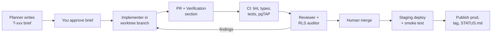

> Copy of the "Reference" tab of the Claude doc "MyChata: tracker and critical review". The doc is the working copy; Claude refreshes this file whenever it edits that tab.

# Reference: critical review and V3 build system

The 25 Sep review: how the product is built, how billing and institutions should work, how to compete by V3, and the agent build system. Read it when a task points here; day-to-day work is on the Now tab (`2026-09-25-critical-review.md`). Some paths and plans here predate later changes (for example, T-021 dropped embeddings for the manual).

## 1. The ecosystem today

The product is sound; the system around it is not yet a business system. The code is small (about 7,000 lines outside the UI kit), which makes now the cheapest moment to fix the foundations.

**What is genuinely good.** Family and institutional modes are cleanly separated. Tasks store both languages instead of translating on render. Consent Mode v2 is set before the tag loads. Public data goes through definer functions, which is the right pattern even where the functions are too open. The migrations show security tightening over time (open policies in `0000`, scoped by `0004`).

| Layer | Today | Problem |
| --- | --- | --- |
| Source of truth | Four places: Notion PRD and Build Log (named in `.lovable/plan/*.md`), the repo (`AGENTS.md`, `roadmap.md`, `.lovable/plan/`, `docs/build-last-3-responses.md`), the workspace `docs/00–09` outside git, and Lovable's chat history | They disagree. `docs/01` plans a Next.js move although TanStack Start already does SSR; `docs/06` specifies OpenAI 1,536-dim embeddings while the code uses Gemini at 768; `docs/07` CI uses npm on a Bun project; `docs/02` puts V2 in Q2–Q3 2026, already past. The workspace docs aren't versioned and Lovable can't see them |
| Build and deploy | Lovable edits `main` directly (116 of 119 commits are the bot, most titled "Changes") and publishes to production | Production is whatever Lovable last published, not what's on `main`. No PR, no CI, no tag of what's live |
| Database | One Supabase project (`envsfjjefkievkwqbrby`) managed by Lovable Cloud; migrations split across `drizzle/migrations` (11) and `supabase/migrations` (2) | No staging database, so every agent migration runs on real family data. `.env.example` tells you to copy the key from the browser's network tab and the service-role key is blank, which suggests you don't hold admin credentials to your own database |
| Vendor coupling | Lovable owns the Vite wrapper, Google OAuth broker (`@lovable.dev/cloud-auth-js`), AI gateway key, error reporting and hosting | Five separate exits to plan, not one. The data exit is the one that matters |
| Business plumbing | Privacy page and consent log exist | No operator identity, terms, or contact on mychata.cz; no email provider (invites are copy-paste links); no billing; no support channel |
| Evidence | Docs mark V1 "✅ shipped" | The build log was verified by the same agent that built it. Defects 1–6 above sit inside ✅ items |

**Recommendation.** Before any V2 work: (1) confirm you can take a full `pg_dump` and hold the service-role key, (2) collapse to one source of truth inside the repo, (3) put a human-merged PR plus CI between every agent and production. Sections 4–6 give the exact setup.

## 2. Structure for subscriptions, including institutional

The billing unit must be the account, and a person must be able to sit in several accounts. Today neither is true (defect 7), so tiers can't be built on the current schema without a data migration. Do it now while there are few real rows.

**Schema changes, in order**

| Change | Why |
| --- | --- |
| `memberships(user_id, account_id, role, status)`, drop the UNIQUE on `members.user_id` | One person in their family's chata, their in-laws' chata and their employer's institution. `members` stays as "people", some without logins (grandma) |
| `profiles.active_account_id` + `is_member(account_id)` / `has_account_role(account_id, role)` helpers | Replaces `current_account_id() … LIMIT 1` and the global `user_roles.admin` |
| `account_id` copied onto `bookings`, `tasks`, `expenses`, `handovers`, `documents` | Every policy and every usage count becomes one indexed check instead of a join through `properties` |
| `plans`, `subscriptions(account_id, plan_id, status, seats, current_period_end, provider_ref)`, `billing_events(provider_event_id UNIQUE, payload)` | Webhooks arrive twice; the unique id makes them idempotent |
| `entitlements` view + `has_entitlement(account_id, feature)` used inside definer functions | Limits (chatas, storage, AI questions, guest links) enforced in the database, not only hidden in the UI |
| `audit_log(account_id, actor, action, target, at)` | Institutions will ask who approved which stay. It is also the base of "compliance reports" |
| Staging project + seed script | Billing and tenancy migrations must never be tried first on production |

**Institutional reality in Czechia.** Universities, municipalities, trade unions and companies with recreation facilities often pay against an invoice, sometimes through procurement, not by card. Several run employee recreation through the social fund (FKSP) or a union budget. So the institutional plan needs annual invoicing with IČO/DIČ, bank transfer with a QR payment code, a named contract owner, and data-processing terms. Card checkout alone won't close these.

**Payments stack.** Keep SaaS billing and marketplace payments separate. For subscriptions, Stripe Billing with Stripe Tax works, or a merchant-of-record service that takes over EU VAT for B2C, worth weighing for a small team. Marketplace money (guest pays, host receives) is a regulated payment flow and belongs in Stripe Connect or a Czech gateway's equivalent, and only in V2.

**Pricing critique (`docs/03-BUSINESS.md`).** The Free tier drops expense tracking, which is the core family feature and the reason relatives join. Families are also your distribution: every invited cousin is a user. A stronger split:

| Tier | Who | Charge for |
| --- | --- | --- |
| Family (free) | One family, 1–2 chatas | Nothing; generous limits |
| Family Plus | Families who rent out spare weeks | Guest links, direct booking, calendar sync, guest registration and tourist-fee reports, more storage, AI manual |
| Institution | Universities, unions, companies, clubs | Per property per year: request queue, eligibility rules, audit log, CSV/ISDOC export, SSO later |

Commission rates tied to plans (12%/8%/5%) should wait until a marketplace exists; putting them in the tier table now anchors a price you can't yet defend. Superseded on 16 Oct by section 10.

## 3. Taking share from Airbnb, Booking.com and Couchsurfing by V3

A head-on marketplace won't take meaningful share by V3. Marketplaces win on guest demand, and Booking and Airbnb buy that demand at a scale MyChata can't match. The winnable route is to own the host's side of the chata (its calendar, money, paperwork and history), then send idle weeks to direct bookings, and only then aggregate demand. Airbnb and Booking are built for strangers renting to strangers; MyChata's ground is the chata that is mostly used by its own people.

**Facts that change the plan**

- Czechs make roughly 8 million stays a year in their own holiday homes ([Česko v datech, Eurostat 2018](https://www.ceskovdatech.cz/clanek/155-chaty-a-chalupy/)). That non-commercial use is the biggest segment and nobody serves it. The "500,000+ properties", "Airbnb ~8,000 CZ cabins" and "17% average commission" figures in `docs/00` and `docs/04` have no source; cite or drop them.
- Airbnb has moved most hosts to a single host-only fee of about 15.5% since October 2025 ([Hostaway](https://www.hostaway.com/blog/airbnb-host-only-fee-what-to-know-about-the-15-percent-host-fee/)). Undercutting commission is a thin wedge; a 0% direct booking the owner controls is a thicker one.
- EU Regulation 2024/1028 applies from 20 May 2026: short-term rentals need a registration number where member states require it, and platforms must collect and share host data ([EUR-Lex summary](https://eur-lex.europa.eu/EN/legal-content/summary/online-short-term-accommodation-rental-services-data-collection-and-sharing.html)). Czechia's eTurista register missed its 1 July 2026 launch and is being reworked; guest book, Ubyport reporting of foreign guests and the local tourist fee still apply ([Hostivio](https://hostivio.cz/en/eturista/)). Paperwork is real pain for small hosts, and a wedge.

**The V2 to V3 path**

| Stage | Move | Why it beats the incumbents | Proof metric |
| --- | --- | --- | --- |
| V1.5 | Win families and institutions: calendar, expenses, handover, manual, vault | Airbnb and Booking have nothing for co-owners. History (repairs, costs, manuals) is switching cost | Weekly active chatas; chatas with 3+ active members |
| V2 | Idle weeks become direct bookings: guest links, friends-of-family pricing, deposit, guest registration, tourist-fee report, registration-number field | Owner keeps 100%; compliance done in the same app | Share of chatas with a live guest link; direct nights per chata |
| V2 | Two-way iCal with Airbnb and Booking; later a channel-manager partner | MyChata becomes the system of record instead of a rival listing | Chatas syncing at least one external calendar |
| V2.5 | Chata swap: owners trade weeks with other owners using points, the HomeExchange model, among verified owners | This is what Couchsurfing's community promised, with trust built on real ownership and known families | Swap nights per month |
| V3 | Public discovery for opted-in chatas only, region by region; AI search once a region has enough supply | Launching demand before supply density loses to Booking's SEO | Bookable chatas per region; search-to-request rate |

**Cut from the V3 roadmap until supply exists:** native app (a PWA plus email and SMS reaches 45–68-year-olds better), microservices and API gateway, Next.js migration, experiences marketplace, insurance, white-label. Each is a year of work that doesn't move the metrics above.

**Obligations a V3 marketplace takes on** (general knowledge, check with a lawyer): Digital Services Act duties for online platforms, including trader traceability for business hosts; DAC7 reporting of host income to tax authorities; Regulation 2024/1028 data sharing; consumer-law terms; payment regulation for holding guest money. Budget for these before announcing a marketplace.

## 4. Folder and MD structure

Move everything an agent needs inside the git repo, and layer it so each agent loads about 200 lines by default and pulls the rest only when the task calls for it. Today the strategy docs sit outside git where Lovable can't see them, `.instructions.md` at the workspace root is probably loaded by no tool (VS Code expects `.github/copilot-instructions.md` or `.github/instructions/*.instructions.md`), and an agent answering a schema question has to read 1,340 lines of `types.ts` plus 13 migrations.

**Four context layers**

| Layer | Loaded | Contents | Budget |
| --- | --- | --- | --- |
| L0 | Always, by every tool | Root `AGENTS.md`: stack, commands, invariants, map of where things live | ≤ 150 lines |
| L1 | When touching that area | Nested `AGENTS.md` in `supabase/`, `src/routes/`, `src/lib/`; one file per domain in `docs/architecture/` | ≤ 100 lines each |
| L2 | Per task | One brief in `docs/tasks/`: goal, files in scope, acceptance checks, links to L1 | ≤ 60 lines |
| L3 | Generated, never hand-edited | `docs/generated/schema.md` (tables, columns, policies, functions), `routes.md`, `STATUS.md` | Regenerated in CI |

**Proposed tree** (rename the repo folder from `my-chata-manager_LovableCodebaseDownload` to `mychata`)

```
MyChata/                       # workspace, not in git
├─ mychata/                    # the repo = single source of truth
│  ├─ AGENTS.md                # L0; keep Lovable's LOVABLE:BEGIN block as is
│  ├─ CLAUDE.md                # one line: @AGENTS.md (+ Claude-only notes)
│  ├─ GEMINI.md                # pointer to AGENTS.md
│  ├─ .github/
│  │  ├─ copilot-instructions.md   # pointer to AGENTS.md
│  │  ├─ pull_request_template.md  # the review checklist from section 6
│  │  └─ workflows/ci.yml
│  ├─ .claude/
│  │  ├─ agents/              # subagent definitions (section 5)
│  │  └─ skills/              # new-migration, rls-audit, release, task-brief
│  ├─ docs/
│  │  ├─ README.md            # index, 20 lines
│  │  ├─ product/             # vision, personas, pricing (from docs/00, 03, 04)
│  │  ├─ architecture/        # tenancy.md, auth.md, rag.md, billing.md
│  │  ├─ decisions/           # ADR-0001-keep-tanstack-start.md … short, numbered
│  │  ├─ tasks/               # T-012-fix-match-manual-chunks.md
│  │  ├─ external/            # inbound work from Lovable, Gemini (section 8)
│  │  ├─ generated/           # schema.md, routes.md (CI writes these)
│  │  └─ STATUS.md            # live commit, open defects, what is verified
│  ├─ supabase/
│  │  ├─ AGENTS.md            # migration + RLS rules
│  │  ├─ migrations/          # ONE migration folder
│  │  ├─ tests/               # pgTAP RLS tests
│  │  └─ seed.sql             # staging only, never production
│  ├─ src/ …                   # unchanged, plus src/routes/AGENTS.md
│  └─ tests/e2e/               # Playwright
├─ private/                    # screenshots with personal data, exports
└─ .env.local                  # never inside the repo
```

**Rules that keep it token-efficient**

- One fact, one file. Every other file links to it instead of restating it (the stack is currently restated in five files).
- `docs/00–09` get split, not copied: decisions become ADRs, plans become task briefs, facts that code can prove get generated.
- `.lovable/plan/*.md` stays Lovable's scratch space; anything that becomes a decision is lifted into an ADR by the reviewer.
- A decision replaced is marked `Superseded by ADR-00xx`, never silently edited, so agents don't resurrect old plans.
- Nested `AGENTS.md` support differs by tool, so the root file must still work alone; nested files add detail only.

**Root AGENTS.md skeleton**

```markdown
# MyChata — agent guide

Stack: TanStack Start 1.168 (SSR, Cloudflare via Nitro) · React 19 · Supabase · Bun. Not Next.js.
Run: bun install · bun run dev · bun run check (lint+typecheck+test)

## Invariants (breaking one = PR rejected)

1. Tenancy: every table has account_id + RLS using is_member(account_id). No SECURITY DEFINER without an account check.
2. Schema changes only as a new file in supabase/migrations/. Never the SQL editor.
3. No direct pushes to main. Branch agent/<tool>/<task-id>, PR, CI green, human merge.
4. Never rewrite pushed history (Lovable sync).
5. User-facing text via t(cs, en). Czech first.

## Where things are

Schema: docs/generated/schema.md · Routes: docs/generated/routes.md · Status: docs/STATUS.md
Tenancy/auth: docs/architecture/tenancy.md · RAG: docs/architecture/rag.md

## Before you finish

Update STATUS.md if behaviour changed. List what you verified and how.
```

## 5. Subagent handover and workflow

Split agents by what they do (plan, build, review, verify), not by topic, and give each task a brief with a file allowlist and runnable acceptance checks. The current plan in `docs/09-AGENT-TASKS.md` splits by topic (Architect, Tester, Analyst…), runs overlapping agents in the same weeks on the same files (Guardian and Commerce both rewrite RLS), and hands them briefs that are wrong: `docs/agents/rag-setup.md` indexes `properties.title`, `description` and `location`, none of which exist; the Growth brief assumes Next.js; the Commerce brief assumes Supabase Edge Functions; Guardian is asked to build consent and data export, which already exist.

**Roles**

| Role | Runs as | Tools | Can write | Output |
| --- | --- | --- | --- | --- |
| Planner | Claude (chat or Claude Code, plan mode) | Read-only repo, docs | `docs/tasks/T-xxx.md` only | A brief (template below) |
| Implementer | Claude Code subagent, one per task, own git worktree | Bun, Supabase CLI against local/staging, Playwright | Files in the brief's allowlist | Branch `agent/claude/T-xxx`, PR with a Verification section |
| UI implementer | Lovable, on its own branch | Lovable editor | `src/routes`, `src/components` | PR, never direct publish |
| Reviewer | Fresh Claude Code subagent that never saw the build | Read-only + `gh pr diff` | PR comments | Findings ranked by severity |
| RLS auditor | Subagent, runs on any PR touching `supabase/` | pgTAP, `supabase db lint`, read-only | Tests only | Pass/fail per invariant |
| Verifier | CI, not an agent | GitHub Actions: lint, typecheck, Vitest, pgTAP, Playwright on staging | Nothing | Green or red |
| Merger | You or Ranaji | GitHub | `main` | Merge, then `STATUS.md` updated |

The skills already available here that fit: `engineering:code-review` for the Reviewer, `engineering:testing-strategy` and `engineering:debug` for the Verifier lane, `engineering:architecture` for ADRs, `engineering:deploy-checklist` before each production publish.

**The workflow for every task**



A red step always returns to the Implementer with the failing output attached, never to a new agent starting cold.

**Parallel work rules**

1. Two tasks run in parallel only if their file allowlists don't overlap.
2. Migrations run in one lane, one at a time, numbered at merge.
3. Any task touching tenancy, auth, billing or RLS gets the RLS auditor and a human read of the SQL, whatever CI says.
4. An agent that needs a file outside its allowlist stops and asks; it does not widen its own scope.

**Task brief template** (`docs/tasks/_TEMPLATE.md`, replaces `docs/specs/_TEMPLATE.md`)

```markdown
# T-012 Close cross-tenant read in match_manual_chunks

Goal: one sentence. Non-goals: what not to touch.
Files allowed: supabase/migrations/NEW, supabase/tests/manual_chunks.sql, src/lib/manual-qa.functions.ts
Invariants touched: 1 (tenancy)
Context (max 5 links): docs/architecture/rag.md, docs/generated/schema.md#manual_chunks
Acceptance (must run green):

- pgTAP: user of account A gets 0 rows for property of account B
- bun run check
  Handoff note: what changed, what was verified and how, what is still unverified.
```

**Order of lanes to V3**

| Weeks | Lane | Content |
| --- | --- | --- |
| 1–2 | Foundation | Data export check, staging project, repo consolidation, CI, branch protection, Lovable on a branch |
| 2–4 | Fix + tenancy | Defects 1–12, memberships migration, pgTAP suite |
| 4–6 | V1.5 | Email provider (invites, reminders), notifications, Sentry, onboarding polish |
| 6–10 | Billing | Plans, subscriptions, entitlements, invoicing for institutions |
| 8–14 | Direct bookings | Guest links v2, deposits, guest registration, tourist-fee report, iCal sync |
| 10+ | RAG + discovery | Section 7 stages |

These are estimates for a small team using agents full-time; adjust after the first two lanes show real velocity.

## 6. Guardrails, review, verification and debug

The code-level guardrails are decent; the process guardrails are missing, which is why defects 1–6 shipped under ✅. There are zero test files, no `typecheck` script, no CI, no branch protection, no staging database, and the only verification is the building agent checking its own work. Nitro runs on a beta build (`3.0.260603-beta`) in production.

**Already in place:** Zod validation on server functions, `requireSupabaseAuth` middleware, RLS enabled on every table, a honeypot on the guest form, timing-safe cron auth, `.env` untracked (the file removed from history held only publishable values).

**Guardrails to add, and which defect each would have caught**

| Guardrail | How | Catches |
| --- | --- | --- |
| Schema drift check | CI runs `supabase gen types` against staging and fails if it differs from the committed `types.ts` | 2 (code writes a column the DB lacks) |
| No ignored database errors | Wrapper or lint rule: every Supabase call must handle `error` | 2, 6 |
| Definer-function lint | CI script: each `SECURITY DEFINER` function must call `is_member`/`current_account_id` or be on a reviewed allowlist; each `GRANT … TO anon` needs an allowlist entry | 1, 3, 4 |
| RLS test matrix | pgTAP: anon, member of A, admin of A, member of B × every table × select/insert/update/delete | 1, 3, 4, 9, 10 |
| E2E on staging | Playwright with 4 test accounts: onboarding, invite an existing user, guest request, make admin, settle expense | 5, 6, 7 |
| Claims ledger | `STATUS.md`: every ✅ links to a test or a dated manual check by someone other than the builder | Docs that overstate |
| Independent review | Reviewer subagent with no build context; human reads every migration | 1, 7, 9 |
| Release tagging | Tag each Lovable publish with the commit; Sentry `release` = commit SHA | Old build live (screenshot) |
| Kill switches | `feature_flags` row per risky feature (AI, guest links) checked server-side | Cost spikes, abuse |
| Rate limits | Per-user daily counters on AI calls and public forms | 11 |
| Dependency hygiene | Dependabot, secret scanning, pinned non-beta Nitro when available | Supply-chain, secret leaks |

**Integrating output from several agents.** The risky joins are schema versus code, and Lovable output versus local agent output. Three rules:

1. The database schema is the contract. Only the migration lane changes it; every other agent regenerates types and adapts.
2. Lovable doesn't run Prettier, so a format check in CI would fail every Lovable PR. Either auto-format in CI on Lovable branches, or make one format-only commit while Lovable is idle. The 60-file reformat sitting uncommitted in your local copy is exactly this collision waiting to happen.
3. The Verification section of a PR must list commands run and their output; "tested" without output counts as untested.

**Debug structure.** Bug report in `docs/bugs/B-xxx.md` (screenshot, URL, time, account type, device) → failing test that reproduces it → fix → the test stays. Sentry for client and server errors, alongside Lovable's reporting until you leave it. For the iOS "?" screenshot, the reproduction is: new Google account, not invited, open `/vice` on the build that is actually live.

## 7. RAG pipeline

There is no working RAG pipeline yet: Stage 1 almost certainly stores nothing (defect 2), and its retrieval function crosses tenants (defect 1). The design also needs changing before it's extended. `docs/06` is a generic reference architecture that doesn't match the code (OpenAI 1,536-dim vs Gemini 768, Supabase Edge Functions vs TanStack server functions).

**Design problems beyond the two defects** (`src/lib/manual-qa.functions.ts`, `0007_*.sql`)

- Rebuild deletes every chunk first, then re-embeds; one failed call leaves the manual unsearchable.
- Members-only and public sections go into one index with no visibility column, so any future guest or public Q&A would leak private sections.
- A whole section is one chunk, with no content hash, so every save re-embeds everything.
- No test questions, so nobody can tell whether retrieval works.

**Target design**

| Piece | Choice |
| --- | --- |
| One table | `rag_chunks(account_id, property_id, source_type, source_id, visibility, lang, content, content_hash, embedding vector(768), model_version, tsv)` with HNSW and GIN indexes, RLS by `is_member` and visibility |
| Ingestion | Triggers on source tables write to `embedding_jobs`; a cron worker (the repo already has `cron-auth.ts`) embeds, upserts by `content_hash`, retries failures. No delete-then-rebuild |
| Retrieval | `search_chunks(…)` as SECURITY INVOKER so RLS applies; hybrid: vector plus full-text with `unaccent` (Postgres ships no Czech stemmer), merged by reciprocal rank fusion |
| Structured data | Bookings, expenses, tasks are queried with SQL tools, never embedded. "Who's at the chata next weekend" is a query, not a similarity search |
| Models | Keep Gemini embeddings (good Czech), pin `output_dimensionality: 768` and record `model_version`. Decide in an ADR whether private manuals go through Lovable's gateway or directly to Google in an EU region; that's a GDPR processor question, not a technical one |
| Evaluation | 40 Czech and English questions per test chata with the expected source ids. CI on staging reports recall@4 and fails below a set bar; a sampled answer-faithfulness check weekly |

**Stages to V3**

| Stage | Sources | Who asks | Unlocks |
| --- | --- | --- | --- |
| 1 (fix) | Manual sections | Members | Working Q&A with citations |
| 2 | + documents (PDF text), handover notes, closed tasks | Members, admins per visibility | "When was the boiler last serviced?", "Where's the pump warranty?" This private history is the data moat |
| 3 | Public listing profiles only, separate index | Anyone | Natural-language discovery, parsed into filters (dates, beds, region, dogs) first, semantic rerank second, only available chatas returned |
| 4 | Stage 2 + SQL tools | Hosts and guests | Host copilot and guest concierge as a tool-using agent, not a bigger prompt |

**Agent-run build of Stage 1 and 2** (each is one brief, one PR, section 5 workflow)

| Task | Owner | Done when |
| --- | --- | --- |
| T-R1 schema + RLS + pgTAP | Migration lane | Tenant-B test returns 0 rows; public/members split proven |
| T-R2 job queue + worker | Implementer | 100 sections embedded on staging, re-save of unchanged text makes 0 calls |
| T-R3 hybrid search function | Implementer | Golden set recall@4 reported in CI |
| T-R4 `askManual` rewrite | Implementer | Answers cite source ids; refuses when nothing is retrieved |
| T-R5 golden set | Planner + you (native Czech) | 40 questions reviewed by a person |
| T-R6 UI | Lovable branch | Sources shown and tappable |
| Review | Reviewer + RLS auditor | On every PR above |

T-R5 needs you rather than an agent: the test questions define what "good" means for Czech users aged 45–68.

## 8. Work from Lovable, Gemini Enterprise and other platforms

`docs/08-EXTERNAL-AGENTS.md` has the right instinct (GitHub as truth, externals on branches) but one contradiction: it moves Lovable to a `lovable/experiments` branch while Lovable still publishes production. Whatever Lovable publishes from that branch goes live, bypassing `main`. So pick a hosting model first; the protocol follows from it.

|  | Model A: keep Lovable hosting (now) | Model B: own hosting (target, about 4–8 weeks) |
| --- | --- | --- |
| Production built from | Lovable publish of `main` | GitHub Actions deploy of `main` to your own Cloudflare Workers (Nitro already targets it; `.wrangler/` exists) |
| Database | Lovable Cloud Supabase | Your own Supabase project, data migrated, you hold the service key |
| Google sign-in | Lovable's broker | Configured directly in Supabase |
| Lovable's role | Edits `main`, UI only, publishes only after CI is green on that commit | One contributor on a branch, PRs like any agent |
| Risk | Lovable can still run SQL on production | Normal PR flow for everyone |

Stay on Model A until the foundation lane (section 5) is done, then move. Moving before tests exist just relocates the risk.

**One protocol for every outside platform**

1. **Inbound packet.** The platform gets a task brief, `AGENTS.md`, `docs/generated/schema.md` and the named files. Never secrets, never production data; staging seed data only. Sending real families' names and phone numbers to an outside AI is a GDPR processing decision that needs a data-processing agreement.
2. **Outbound landing.** Code arrives as a PR from `agent/<platform>/<task-id>`. Research and content arrive as `docs/external/<platform>/YYYY-MM-DD-<topic>.md` with frontmatter `source`, `model`, `date`, `status: draft|reviewed|adopted`.
3. **Same gates.** CI, Reviewer, RLS auditor and human merge apply regardless of which platform wrote it.
4. **Output is data.** Text from outside platforms is never run as a command or pasted into prompts as instructions without a person reading it.

**Per platform**

| Platform | Use it for | Never | Access it gets |
| --- | --- | --- | --- |
| Lovable | UI screens, copy, visual iteration | Migrations, RLS, auth, billing, server functions (put this in Lovable's project Knowledge and in `AGENTS.md`) | Repo via its GitHub app |
| Gemini Enterprise | Market and regulation research, Czech content drafts, Workspace docs | Code merged without PR; production data | Read-only Drive/GitHub connectors; GA4 data through the free BigQuery export rather than live DB access |
| Claude (Code, chat, this workspace) | Planning, implementation in worktrees, review | Direct push to `main` | Repo, staging database |
| Copilot / Cursor / others | Inline edits in the IDE | Changing invariants files without review | Local repo |
| MCP servers (Supabase, GitHub) | Letting agents inspect schema, PRs, issues | Write access to production | Supabase MCP in read-only mode pinned to the staging project; GitHub token scoped to one repo, no admin |

**Notion.** The Lovable plans cite a Notion PRD and Build Log. Either move their decisions into the repo as ADRs and mark Notion as archive, or keep Notion as the product source and have the repo link to page URLs. Two live copies is how `docs/02` ended up planning a Q2 2026 V2.

## 9. Two maintainers and the Lovable setup (26 Sep)

Add Rajat as a collaborator on the existing repo now. Don't move the repo or leave Lovable yet: stay on Model A with a ruleset until staging and signed-in tests exist, then move to Model B. Rajat and you each work on your own branches. Lovable stays the only thing that writes straight to main, and only for screens.

**The repo.** It lives at ranaji10/mychata (public). GitHub has no way to add an account "as a branch". Instead, add Rajat under Settings → Collaborators with the Write role. He then works on branches named after his GitHub username and opens PRs like everyone else. Keep the repo where it is for now, because Lovable's sync is tied to it and moving or renaming it can disconnect Lovable. When you move to Model B, transfer it to a GitHub organization you both own, so the business doesn't depend on one personal account.

**The Lovable link.** Lovable was reconnected to the repo on 27 Sep and pulls from main on the next merge; it can't pull retroactively. Write down who holds the Lovable workspace, its publish button and its billing (Open tasks). Don't reconnect it again without need: each reconnection risks a new repo and split history.

**Guardrails for two people.** The CI migration guard, the sync check with its git hooks and VS Code task, and the two-person runbook are live since PR #7 (see Completed). The rulesets on `main` were redone on 12 Oct (see "GitHub settings check" in Completed); Lovable now works on the branch lovable-sync and reaches main through a PR.

**Lovable environment.** Keep one Lovable workspace with both of you as members, and one person driving it at a time. It edits main for screens and wording only, under the Knowledge rules, with nothing published before CI is green. The prompt batches L-1 to L-3 follow those rules.

**Leaving Lovable for Claude via MCP?** Claude already does everything except screens, through PRs. You could stop using Lovable's editor any day. But Lovable also hosts the site, runs the database, brokers Google sign-in and holds the AI key, and an MCP connection replaces none of these. So the real move is Model B, in this order: staging (T-003) → signed-in end-to-end tests (T-004) → own Supabase and hosting (T-002). Moving before those exist just moves the risk. The 4–8 week estimate stands. Give agents the Supabase MCP only read-only, and only against staging.

**Lovable's MCP connector for Claude: not now.** It connects from Claude's side, not from Lovable's workspace settings. It gives Claude your whole Lovable account, including running SQL on the live database and publishing, and it would bypass every PR, CI and migration rule above. Lovable's own "chat connectors" work the other way (Lovable's agent reaching your tools), so a Claude connector there adds nothing.

**Email: decided.** Lovable's built-in email, from no-reply@notify.mychata.cz, with replies going to podpora@mychata.cz. It's included in paid workspaces, needs no extra vendor, and covers sign-in emails too. Steps: docs/tasks/T-005-email.md; prompts L-E and CC-3 are in the prompts doc.

**AI and credits.** Every AI call and email bills to the Lovable workspace "My Lovable", which holds the project. The monthly AI grant is used first, then general credits. When credits run out, the manual shows the best-matching excerpt instead of an AI answer. This is recorded in docs/architecture/environments.md.

**Sharing this doc with Rajat.** Edit rights in a Claude doc only reach people in the same Claude organization; a public link is read-only. Three routes:

1. **Claude Team plan** with both of you as members (third-party reports put it at a 2-seat minimum; check claude.com/pricing). Then Share gives him edit rights, and you can share Projects too.
2. **Ask Anthropic** for cross-account editing: use the thumbs-down feedback button in the app, or support.claude.com.
3. **Use the repo as the live tracker** (recommended now). Every Claude session, yours or his, already writes its results into the repo through PRs: docs/STATUS.md, the task briefs, and copies of Claude docs in docs/external/claude/. GitHub Issues can hold the to-do list, with comments from both sessions. It has history, needs no new tools, and two sessions can't overwrite each other.

A Google Doc edited by two Claude accounts through the Drive connector won't work. The connector available here can create files and rename or move them, but it can't edit an existing document's content. Even with a connector that could, two sessions writing the same doc would overwrite each other without warning.

## 10. Pricing strategy (16 Oct)

Keep Gemini's frame (per chata, unlimited members, annual billing, invoices for institutions) but drop its prices on features that don't exist. Families stay free for everything V1 does. The first revenue comes from institutions, through invoiced pilots. A paid family tier, Rodina Plus, launches only when the rental toolkit (T-010, T-011) ships. Every number below is a hypothesis to test in the O-12 interviews. Decisions D-18 to D-21 on the Now tab; build steps P-1 to P-13 below.

**Gemini's draft, point by point** ([source doc](https://docs.google.com/document/d/1STwfNTXC5HTnD5e4thaMhWX_NiqST5MuoCX8GX-JzM8/edit))

| Gemini proposed | Verdict | Why |
| --- | --- | --- |
| Price per chata, unlimited members | Keep | Every invited relative is distribution. Applies to the free tier too |
| Free: 1 chata, 5 members, no Document Vault, "manual" expense notes | Change | Contradicts the 25 Sep decision: expenses and settlement are why relatives join. A 5-member cap breaks Gemini's own viral-loop argument |
| Rodina Pro 1,900 Kč/yr: unlimited members + AI Document Vault | Change | Charges families for the core product. The vault's AI search isn't built (N-6, T-020), so it can't be the paywall yet |
| Pronájem 490 Kč/month: guest portal, iCal, analytics, check-in briefs | Merge into Rodina Plus | Same buyer as Rodina Pro (families who rent out weeks). iCal (T-011) and guest registration (T-010) aren't built |
| Annual billing anchor | Keep, annual only | Avoids the November churn Gemini names; one card charge a year keeps fees low |
| AGPL self-hosted edition, dual licence | Park | Depends on O-07 (public or private, licence). Ownership of Lovable-generated code and contributions is unclear. Chata families don't self-host |
| Seasonal pass 1,350 Kč (Apr–Sep) | Drop | Invites downgrades and adds billing states for little revenue |
| Extra chata +120 Kč/month | Keep, as +490 Kč/yr | Fits the annual-only model |
| AI or storage top-up packs | Later | Need real usage and cost data first (P-5 measures it) |
| Founding price 1,200 Kč/yr "forever" | Change | No lifetime prices. Founding price locked for the first 3 years instead |
| Institutions: 14,900 / 34,900 / 69,000–120,000 Kč/yr by lodge count | Change | Keeps the 25 Sep decision: per object per year. SSO, lottery allocation, FKSP payroll export, Pohoda/SAP exports and "Vertex AI tenant isolation" don't exist (AI runs through Lovable's gateway), so they can't carry a price now |
| "Under 40,000–50,000 Kč needs no tender" | Partly right | The legal limit for small contracts is 3,000,000 Kč without DPH since 3 Apr 2025 ([CRR](https://crr.gov.cz/wp-content/uploads/2025/05/Informace-Centra-ke-zvyseni-limitu-VZMR-po-novele-3.-4.-2025-a-zvyseni-limitu-pro-primy-nakup_FINAL.pdf)). What decides at these prices is each institution's internal signing limit. Ask in interviews |
| Annual invoice, 30-day due date; budgets spent Oct–Dec | Keep | Already in `docs/architecture/billing.md` |
| One-off "Digitalizace chaty" setup 9,900 Kč | Keep as optional "Zavedení" | Priced as your time. Document ingestion only once AI search works |
| Room/bed units, peak-week quotas, domain sign-up, stay-fee reports | Keep as institution roadmap | They justify a later Instituce+ tier, not today's price |
| 0% commission positioning | Keep | Matches `docs/product/strategy.md` |

**Final tiers**

| Plan id | Name (CZ / EN) | Who | Price | What it adds | Sold from |
| --- | --- | --- | --- | --- | --- |
| `family_free` | Rodina / Family | Families sharing 1–2 chatas | 0 Kč | All of V1: calendar, tasks, expenses and settlement, handover, manual, vault, guest booking link, public calendar | Now |
| `family_plus` | Rodina Plus / Family Plus | Families who rent out spare weeks, or have more chatas | 1,490 Kč/yr incl. 2 chatas; +490 Kč/yr per further chata (max 5). Founding: 990 Kč/yr, locked 3 years, first 100 accounts | Rental toolkit: guest book and registration, stay-fee report, deposits, registration-number field (T-010); iCal with Airbnb/Booking (T-011); guest questions on the public manual; more storage and AI | When T-010 ships; a "Chci vědět" interest button before that |
| `institution` | Instituce / Institution | Universities, unions, companies, clubs | 9,900 Kč/yr per object without DPH; each further object 6,900 Kč. Optional Zavedení 6,900 Kč one-off | Request queue and approvals, audit log, CSV export, domain-restricted sign-up, invoice with QR payment | Now, as pilots (D-20) |
| `institution_trial` | Instituce, zkušební / Trial | New institutional sign-ups | 0 Kč for 60 days | Same as Instituce | Now |
| `institution_plus` | Instituce+ | Faculties or networks with 3+ objects | From 39,000 Kč/yr, quoted | Room/bed units, peak-week quotas, SSO, FKSP and payroll exports | When those features exist |

Why these numbers: 1,490 Kč is about one night's rent for a renting family and a fraction of Airbnb's ~15.5% host fee on a single rented week. 9,900 Kč per object sits below Gemini's 14,900 because today's institutional feature set is thinner; raise it for new customers when quotas and room units ship. Rough ceiling at 100 Plus accounts and 10 institutions with 1.5 objects each: about 300,000 Kč a year, half from each. Institutions get there with far fewer sales.

**Entitlements** (what each plan's `limits` row holds; `null` = unlimited)

| Key | family_free | family_plus | institution (+ trial) | Enforced by |
| --- | --- | --- | --- | --- |
| `properties` | 2 | 2 + paid extras, max 5 | paid objects (`subscriptions.seats`) | `add_property` (P-6) |
| `members` | null | null | null | none needed |
| `storage_mb` (per account) | 1000 | 10000 | 20000 | upload check (P-6) |
| `ai_questions_per_day` (per account, not per user) | 20 | 100 | 500 | `bump_account_usage` (P-5) |
| `guest_links` | true | true | true | exists |
| `rental_toolkit` | false | true | false | T-010, T-011 call `has_entitlement` |
| `public_manual_qa` | false | true | true | manual Q&A on public pages |
| `request_queue`, `audit_export`, `domain_signup` | false | false | true | institution screens |
| `read_only` | false | false | false (true on `institution_lapsed`) | write policies (P-8) |

**When payment stops.** Nothing is deleted. A family falls back to Rodina; content above its limits stays readable and downloadable, but nothing new is added there. An institution gets 30 days as `past_due`, then `institution_lapsed`: read-only, exports and document downloads still work. This also answers the open question on what happens to documents when someone stops paying.

**Gates before anyone is charged** (in this order)

1. **Legal operator** (O-11): a company or sole trader to issue invoices, terms of service (B2C and B2B), the withdrawal-right consent for a digital service, a data-processing agreement for institutions. No invoice can go out without this.
2. **VAT status.** Below 2 million Kč turnover the operator need not register ([VATCalc](https://www.vatcalc.com/czech/czechia-vat-guide/)). Then family prices are final and institutions see "neplátce DPH". After registration, keep 1,490 Kč as the price including DPH.
3. **Interviews** (O-12): 10 families and 3 institutions, each asked how they split costs today, what they would pay a year, who signs and up to what amount, and whether FKSP or a union budget pays.
4. **Staging** (O-08) before the billing migrations P-2 to P-8. Billing and tenancy changes are never tried first on production.
5. **Rental toolkit** (T-010) live before Rodina Plus is sold.

**Pricing build steps** (backlog row O-18). Each P row is one task brief in `docs/tasks/` and one PR. P-1 to P-8 can ship dark behind a `billing_enabled` flag set to false, so nothing changes for users until the gates pass.

| ID | Change | Where | Done when | Owner | Needs |
| --- | --- | --- | --- | --- | --- |
| P-1 | Product docs to pricing v2 | `docs/product/pricing.md`, `docs/architecture/billing.md`, `docs/tasks/T-009-billing.md` | Pricing.md shows the tiers and entitlements above; T-009 lists P-2 to P-12 | Claude | D-18 |
| P-2 | Plans v2: add `price_czk_year`, `extra_property_czk_year`, `vat_included`, `public`, `sort` to `plans`; upsert `family_free`, `family_plus`, `institution`, `institution_trial`, `institution_plus`, `institution_lapsed` with the limits above; add flag `billing_enabled` (off) | New migration in `drizzle/migrations/`; `docs:gen` | `select * from plans` matches the Entitlements table; schema.md regenerated | Claude (migration lane) | Staging (O-08) |
| P-3 | Fix `account_plan()`: today every institutional account without a subscription gets the full `institution` plan for free, forever. New institutional accounts get a `trialing` subscription ending after 60 days; expired trials resolve to `institution_lapsed`; existing institutional accounts are backfilled as pilots (`provider = 'pilot'`, period end 30 Sep 2027) | Same migration as P-2, or the next one | pgTAP: new institution = trial; trial past end = lapsed; pilot = institution | Claude | P-2, D-20 |
| P-4 | Price locks: `subscriptions.price_czk_year`, `price_locked_until`, `deal` (`founding`, `pilot`, `list`) | Migration | Founding and pilot prices survive a list-price change | Claude | P-2 |
| P-5 | AI limit per account, read from the plan: `usage_counters` gets `account_id`; new `bump_account_usage(account_id, kind)` checks membership and `plan_limit(account, 'ai_questions_per_day')`; `manual-qa` and `task-translation` switch to it. Log the Lovable credits each question costs | Migration; `src/lib/manual-qa.functions.ts`, `src/lib/task-translation.functions.ts` | pgTAP: member of A can't count against B; the 21st question on Rodina is refused; cost per question noted in `docs/architecture/environments.md` | Claude | P-2 |
| P-6 | Enforce limits in the database: `add_property` checks the property allowance (`subscriptions.seats` or plan limit); uploads check `storage_used_mb(account)` against `storage_mb`; new `has_entitlement(account, key)` helper | Migration; upload server functions | pgTAP: a third chata on Rodina is refused; an upload over the limit returns a clear Czech error | Claude | P-2 |
| P-7 | `account_entitlements(account)`: plan, limits, usage today (AI, storage, chatas), period end; for the Settings screen | Migration | Returns one row for admins of the account only | Claude | P-5, P-6 |
| P-8 | Lapsed means read-only: write policies check `not has_entitlement(account, 'read_only')`; exports and document downloads stay open | Migration | pgTAP: lapsed admin can read and export, can't insert | Claude + RLS auditor | P-3, P-6 |
| P-9 | Settings → "Předplatné / Plan": current plan, usage bars, period end; for institutions an IČO/DIČ form and "Požádat o fakturu", stored as a `billing_requests` row and e-mailed to podpora@mychata.cz | Lovable (screen); Claude (table, server function) | An admin sees usage and can request an invoice; members don't see the section | Lovable, Claude | P-7, e-mail (N-5) |
| P-10 | Public `/cenik` page: Rodina, Rodina Plus ("Brzy" + "Chci vědět" interest button), Instituce ("Požádat o nabídku"); Czech first; DPH note per the VAT gate | Lovable | Live at 375px and 1280px; links from home and footer | Lovable | D-18 |
| P-11 | Analytics events: `pricing_viewed`, `plan_interest_clicked(plan)`, `limit_reached(kind)`, `invoice_requested` | `docs/product/analytics.md`; event calls in P-9, P-10, P-6 errors | Events visible in GA4 debug view | Claude | P-9, P-10 |
| P-12 | Payments (T-009). Institutions first: invoices with QR payment from a Czech invoicing tool (Fakturoid or iDoklad); a service-role script records each payment in `billing_events` (`provider = 'invoice'`) and updates `subscriptions`. Families: Stripe Checkout, annual, CZK, webhook route, only when Rodina Plus launches | Server route; `scripts/` | A test invoice marked paid turns a trial into `institution`; a webhook retry changes nothing | Claude, you | Gates 1–2 |
| P-13 | Legal pages: obchodní podmínky (B2C, B2B), withdrawal-right consent at checkout, data-processing agreement, operator identity in the footer | `/podminky`, footer | Reviewed by a lawyer; linked from `/cenik` and checkout | You | O-11 |

**Questions you haven't asked yet on pricing**

| Question | Why it matters |
| --- | --- |
| What does one AI question cost in Lovable credits? | Sets whether 20 a day per free account is affordable at 1,000 accounts. P-5 measures it |
| Who signs the invoice: you, Rajat, or a company you both own? | Revenue, tax and liability follow the operator; it also settles the business split |
| Do the institutional accounts that exist today (D-08) know a price is coming? | Turning a free tool into a paid one without notice loses the pilots you most need |
| Is the 14-day withdrawal right handled for families? | EU consumers can cancel a digital service unless they agreed to immediate start; checkout needs that tick box |
| Will you sell outside Czechia? | Euro prices and EU VAT (OSS) come with it; keep CZK only until then |

## Questions you haven't asked yet

| Question | Why it matters |
| --- | --- |
| Can we take a full export of the production database today, and who holds its admin key? | If the answer is "only Lovable", every other plan here depends on a vendor's goodwill |
| How many real families and institutions use it weekly, and what have ten of them said? | Nothing in the folder records a user conversation. Pricing, the free tier and the V3 path are all guesses until then |
| Who is the legal operator, and who has merge rights? | mychata.cz shows no operator, terms or contact. Two people (the Mac user and the `ranaji10` GitHub owner) with unclear decision rights will collide once agents open PRs daily |
| Why AGPL-3.0, added this morning, on a private commercial repo? | It barely matters while private, but opening it later, or dual-licensing, needs a deliberate choice about who owns contributions. Check Lovable's terms on generated code |
| Is "My Chata" / mychata.cz clear to trademark in CZ and the EU? | Cheap to check at ÚPV and EUIPO now, expensive after a brand campaign |
| What happens to a family's documents if they delete their account or stop paying? | Ownership deeds and insurance papers live in the vault; retention, export and deletion rules must exist before billing |
| Are backups and point-in-time recovery on, and has a restore ever been tested? | One bad agent migration on the only database is the most likely serious incident |
| Who pays for AI calls, and at what usage does the free tier stop being free? | Answered 26 Sep: the "My Lovable" workspace pays, and daily caps exist since migration 0015. Still open: auto top-up yes or no |
| How many hours a week does this get against the other ventures? | The lane plan in section 5 assumes steady attention; a V3 marketplace needs a funded growth budget on top |
| What tells us production is broken, and who reads it? | The nightly check failed five nights in a row and nobody acted. GitHub's failure emails reach one account; T-006 plus a channel you both read fixes that |
| Which commit is live right now? | There is still no release tag. What's live was worked out on 4 Oct from the site's behaviour. A tag after every publish answers it in one click |
| Who is the second person for two-person tests until staging exists? | Settle debts, invitations and demotion need two real accounts. Agree which accounts, use test cottages only, and delete them afterwards |
| Should our status, bug reports and plans be public? | The repo is public, so all of docs/ is. Fine for code; less so for business plans and anything that names a person |

## Sources

- [Online short-term accommodation rental services: data collection and sharing (EUR-Lex summary of Regulation 2024/1028)](https://eur-lex.europa.eu/EN/legal-content/summary/online-short-term-accommodation-rental-services-data-collection-and-sharing.html)
- [eTurista 2026: not launched on 1 July (Hostivio)](https://hostivio.cz/en/eturista/)
- [Airbnb host-only fee explained (Hostaway)](https://www.hostaway.com/blog/airbnb-host-only-fee-what-to-know-about-the-15-percent-host-fee/)
- [Chaty a chalupy (Česko v datech, Eurostat 2018 data)](https://www.ceskovdatech.cz/clanek/155-chaty-a-chalupy/)
- Code evidence: `MyChata MVP` folder on your Mac, repo commit `23d71f2` plus uncommitted local changes, read on 25 Sep 2026; live home page of mychata.cz on the same date.

---

Source file: `docs/external/claude/2026-09-25-critical-review.reference.md`
